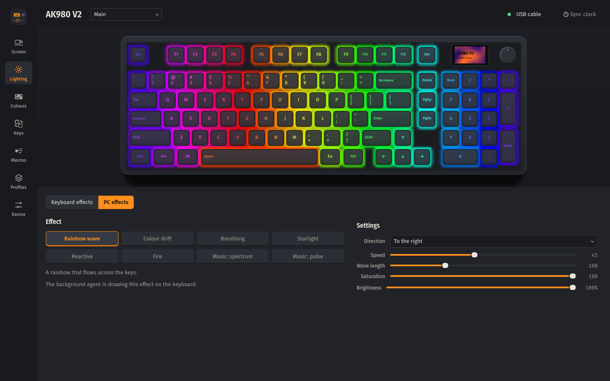
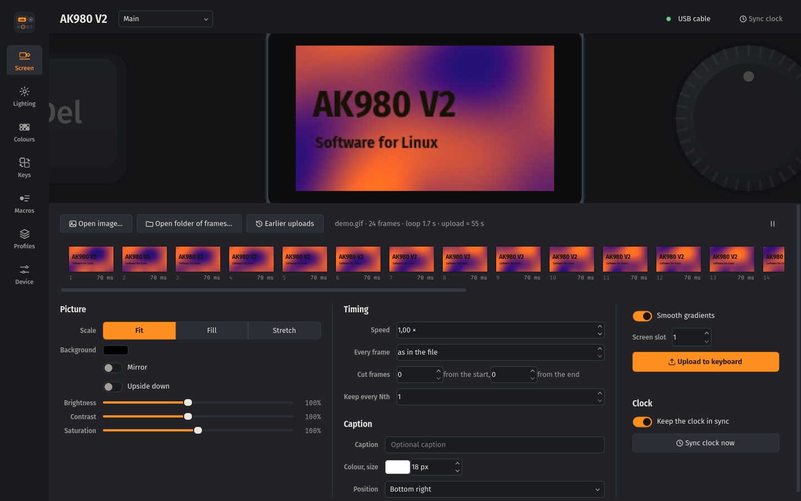
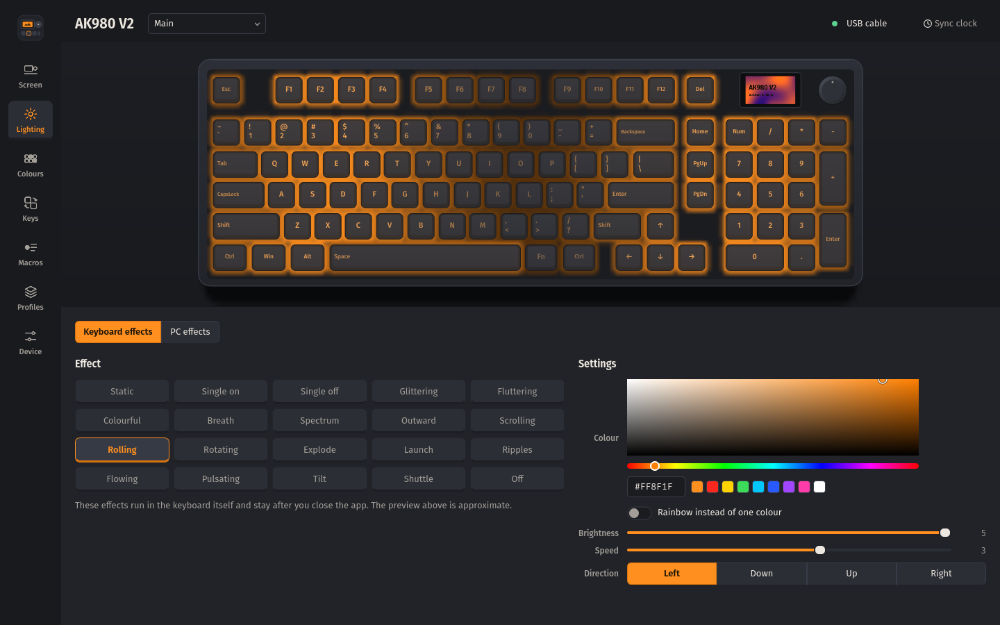
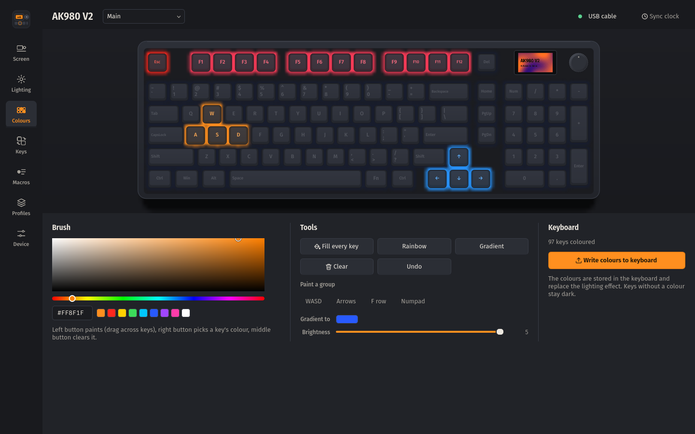
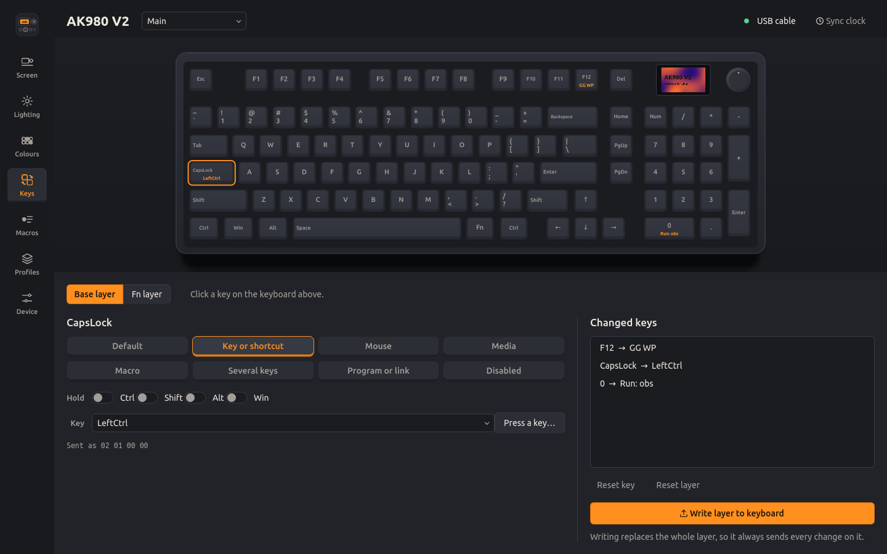
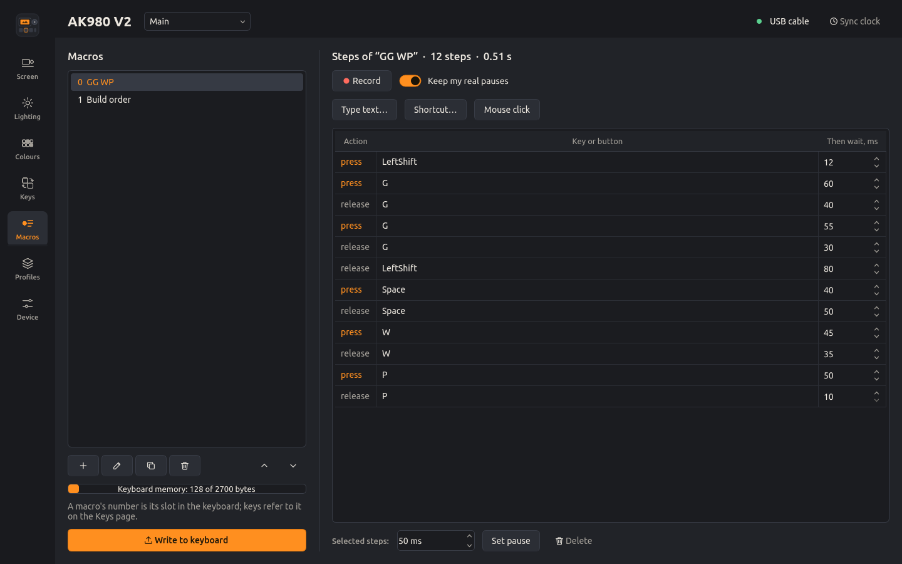
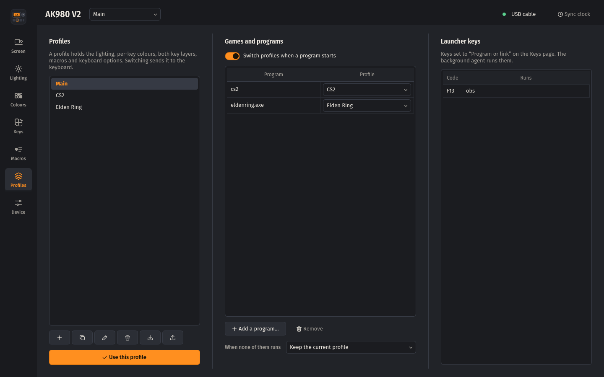
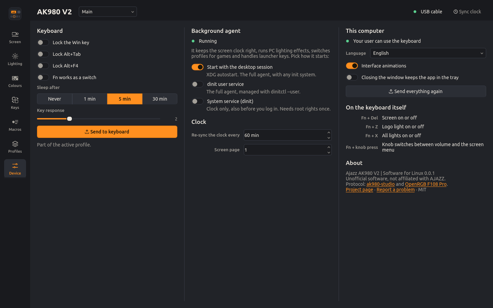

# Ajazz AK980 V2 | Software for Linux

[Українська](README.uk.md) · [Protocol](docs/PROTOCOL.md) · [Design](docs/DESIGN.md) · [Changelog](CHANGELOG.md)

Configuration software for the **AJAZZ AK980 V2** keyboard that runs on Linux. The vendor's driver
only exists for Windows; this app covers what it does and adds what it could not: the screen clock
keeps itself in sync with your system, lighting effects can be computed on the PC (music spectrum,
reactive typing, fire), and profiles switch when a game starts.



> Unofficial software, not affiliated with AJAZZ. [docs/PROTOCOL.md](docs/PROTOCOL.md#what-has-been-verified)
> lists which commands were checked on a real AK980 V2 and by whom.

## What it can do

| | USB cable | 2.4 GHz dongle |
|---|---|---|
| Keep the screen clock in sync (on connect, after sleep, at midnight, hourly) | yes | yes |
| GIFs, pictures and frame folders on the 240×135 screen, with a frame editor | yes | no (firmware) |
| 19 lighting effects of the keyboard: colour, rainbow, brightness, speed, direction | yes | no (firmware) |
| Per-key colours, painted on a drawing of the keyboard | yes | no (firmware) |
| Lighting effects computed on the PC, streamed at 30 fps | yes | no (firmware) |
| Key remapping on the base and Fn layers: keys, shortcuts, mouse, media, macros, several keys, programs and links | yes | no (firmware) |
| Up to 100 macros, recorded from the keyboard or typed in | yes | no (firmware) |
| Profiles, switched by hand, from the tray or automatically for a game | yes | lighting stays |
| Win, Alt+Tab and Alt+F4 locks, Fn as a switch, sleep timer, key response | yes | no (firmware) |
| Battery level | no (the keyboard does not report it) | yes |

The keyboard only accepts configuration over the cable; the vendor's driver has the same limit.
Over the dongle it takes the time and reports its battery.

PC effects: rainbow wave, colour drift, breathing, starlight, reactive keys (pressed key, ripple or
cross), fire, music spectrum and music pulse. The preview in the app runs the same code that drives
the keyboard, so what you see is what the keys show.

## Install

### Arch Linux, Artix and derivatives

```bash
git clone https://github.com/yellowhearth1/ajazz-ak980-v2-linux
cd ajazz-ak980-v2-linux/packaging/arch
makepkg -si
```

`makepkg -si` downloads the release the PKGBUILD names, checks its checksum, then builds and installs
`ajazz-ak980-v2-linux`. To build the checkout itself instead, run `make dist` and copy
`dist/*.tar.gz` into `packaging/arch` first, then `makepkg -si --skipchecksums` (the checksum is
the release's).

The PKGBUILD is a split package in the Artix style; install the service package for your init
system next to it if you want a system service: `ajazz-ak980-v2-linux-dinit`, `-openrc`, `-runit`
or `-s6` (the systemd units are in the main package).

### AppImage (any distribution)

Download `Ajazz_AK980_V2-<version>-x86_64.AppImage` from the
[releases](https://github.com/yellowhearth1/ajazz-ak980-v2-linux/releases), make it executable and
start it. On first start the app asks once for your password to install the rule that lets your
user talk to the keyboard. `./Ajazz_AK980_V2-*.AppImage time` and every other command work too.

### From source, for your user

```bash
./install.sh            # ~/.local, asks for sudo only to install the udev rule
./uninstall.sh
```

Needs Python 3.10+, PyQt6 with QtSvg, Pillow and numpy from your distribution.

### Other distributions (packagers)

```bash
python -m build --wheel --no-isolation
python -m installer --destdir="$DESTDIR" dist/*.whl
make DESTDIR="$DESTDIR" PREFIX=/usr install-data install-systemd   # + install-openrc / -dinit / -runit / -s6
```

## First start

1. **Access.** Packages install `/usr/lib/udev/rules.d/60-ajazz-ak980.rules`. If the keyboard was
   already plugged in, reconnect it once or press *Allow access*. Without a package, *Allow access*
   (or `ak980 setup`) installs the rule. The rule opens only the interfaces the app talks to: screen
   and commands on the cable, the two vendor interfaces on the receiver. The interfaces that carry
   what you type stay root's, so other programs cannot read your key presses through them.
2. **Background agent.** It keeps the clock right, runs PC effects, switches profiles and handles
   launcher keys. Packages start it with your desktop session. To run it as a service instead, pick
   it on the *Device* page or:

| Init system | Full agent (per user) | Clock only, system-wide |
|---|---|---|
| any desktop | starts with the session (XDG autostart) | |
| systemd | `systemctl --user enable --now ak980-agent` | `systemctl enable --now ak980d` |
| dinit | `dinitctl --user enable ak980-agent` | `dinitctl enable ak980d` |
| OpenRC | session autostart | `rc-update add ak980d default && rc-service ak980d start` |
| runit | session autostart | `ln -s /etc/runit/sv/ak980d /run/runit/service/` |
| s6 | session autostart | `s6-service add default ak980d-srv && s6-db-reload` |

`ak980 service list` shows what your system offers and what is enabled.

## The app

Start *Ajazz AK980 V2* from the menu, or `ak980` without arguments. The keyboard is drawn from its
real layout and every page works on it.

| | |
|---|---|
|  | **Screen.** Open a GIF, a picture or a folder of numbered frames. Fit, fill or stretch it; adjust brightness, contrast and saturation; change the speed or give every frame the same delay; cut frames or keep every Nth one to fit the 140-frame limit; add a caption. The strip shows every frame with its delay: select one to change its delay or delete it. The preview is the exact 16-bit image the panel will show. Uploading takes about 0.15 s per 4 KiB page. Every upload is kept under *Earlier uploads*, because the keyboard cannot give an animation back. |
|  | **Lighting.** *Keyboard effects* are the 19 effects of the firmware; they stay when the computer is off. *PC effects* are computed here and streamed to the keys; they run while the app or the agent runs. |
|  | **Colours.** Paint keys: left button paints (drag across keys), right button picks a key's colour, middle button clears it. Fill, rainbow, gradient, WASD, arrows, F row and numpad in one click. The colours are stored in the keyboard. |
|  | **Keys.** Click a key, choose what it does on the base layer or while Fn is held: another key or a shortcut, a mouse button or the wheel, a media key, a macro (once, N times, until pressed again, while held), up to three keys at once, a program or a link, or nothing. *Program or link* sends one of the spare keys F13–F24, which the agent turns into the program. |
|  | **Macros.** Record from the keyboard with or without your real pauses, type text, add shortcuts and mouse clicks, edit every pause. A bar shows how much of the keyboard's macro memory is used. |
|  | **Profiles.** A profile is everything the keyboard holds plus the PC effect. Switch from the header, the tray or here; export and import them as files. *Games and programs* switches a profile while a program runs (`cs2`, `eldenring.exe`, …). |
|  | **Device.** Keyboard options, the clock, how the agent starts, access, language. |

## Command line

```bash
ak980 status                                 # connection, battery, profile, agent
ak980 time                                   # set the screen clock now
ak980 lcd ~/Pictures/cat.gif --fit fill      # upload to the screen (kept in ~/.local/share/ak980/history)
ak980 lcd cat.gif --preview out.gif          # only see how it will look
ak980 light rotating --rainbow on            # a keyboard effect
ak980 fx spectrum palette=fire sensitivity=70   # a PC effect (ak980 fx --list)
ak980 custom --all 101820 --wasd ff8f1f      # per-key colours
ak980 remap CapsLock key:ctrl                # remap; --fn for the Fn layer, --dry to see the bytes
ak980 macro add "GG" "text:gg wp" && ak980 remap F12 macro:0
ak980 launch F13 obs && ak980 remap F1 key:F13 --fn
ak980 profile new Gaming --copy && ak980 auto add cs2 Gaming && ak980 auto on
ak980 service enable dinit-user              # how the agent starts
```

`man ak980` and `ak980 <command> --help` have the details. Bash, zsh and fish completions are
installed with the package.

## Troubleshooting

**"No access to /dev/hidraw…"** — the udev rule is missing or the keyboard was plugged in before it
was installed. Run `ak980 setup` (or *Allow access*): it installs the rule when needed and applies it
to the connected keyboard. Reconnecting the keyboard works too.

**Updating from 0.0.1.** The 0.0.1 rule also opened the interfaces that carry key presses. The new
one closes them whenever udev applies it: the Arch and Artix packages do that while installing.
Without a package, run `ak980 setup` once; it replaces the old copy in `/etc/udev/rules.d`. To check,
`ak980 list` shows which `/dev/hidrawN` is which interface (`if0`…`if4`), and `ls -l /dev/hidraw*`
should show `crw-------` (root only) on the cable's `if0` and `if1` and the receiver's `if0`–`if2`.
If one is still open, reconnect the keyboard and its receiver once.

**Only the clock works.** The keyboard is in 2.4 GHz or Bluetooth mode. Connect the cable and switch
the keyboard to wired mode; the vendor's driver has the same limit.

**Music effects stay dark.** They record what the PC plays through `parec` (PulseAudio, or PipeWire
with pipewire-pulse) or `pw-record`. Install one of them.

**Reactive effects ignore typing.** Reading key presses needs the `input` group:
`sudo usermod -aG input $USER`, then log in again. Clicking keys in the app still works.

**Keys stop arriving over 2.4 GHz.** Besides the keyboard, the receiver has two vendor interfaces.
Windows and macOS read them all the time; Linux reads an interface only while a program has it open.
Receivers like this one can stop answering on every interface when a report waits unread there, and
the same receiver (`0c45:fefe`) is reported to drop under Linux but not under macOS. The agent keeps
both interfaces open while the receiver is plugged in, so keep it running. The kernel can do the same
on its own: add `usbhid.quirks=0x0c45:0xfefe:0x400` (`HID_QUIRK_ALWAYS_POLL`) to the kernel command
line.

The agent also records the link in `~/.local/state/ak980/link.log`: once a minute it asks the
keyboard for its battery over 2.4 GHz and writes down every change, and when you switch to the
cable. After a dropout the last lines tell what failed: *did not take the request* means the
receiver stopped answering the PC, *did not answer* means the radio link, and no change at all means
the keyboard was still reachable. Please open an issue with that file and the end of `dmesg`.

Placement matters too: a receiver behind the metal case or next to Wi-Fi gear loses the keyboard.
Put it on a USB extension cable or a front port, and not on the same USB 2.0 hub as an audio
interface or USB microphone. Tools like `powertop --auto-tune` can suspend the receiver; exclude it.

**The screen jumped to another page after a clock sync.** The vendor app sends a screen page with the
time; this app sends page 1 like it does. Change it on the *Device* page if your screen uses another.

## How it works

The keyboard is a SONiX design. Configuration goes through 65-byte feature reports on interface 3
(usage page `0xFF13`), screen data through 4 KiB output reports on interface 2 (`0xFF68`), and the
dongle takes 33-byte output reports on its interface 3 (`0xFF60`). [docs/PROTOCOL.md](docs/PROTOCOL.md)
documents every command this app uses, which of them were checked on the AK980 V2, and what is still
unknown.

Hardware facts worth knowing:

* the real-time stream is `04 20` + 8 packets of `[index R G B]` + `04 02`; it runs up to ~70 fps,
  but reports sent less than ~1 ms apart make the keyboard stall the USB pipe;
* the logo light next to the arrows is not addressable from the PC;
* an animation cannot be read back from the keyboard.

## Credits

The wired protocol was reverse engineered in
[donglover69/ak980-studio](https://github.com/donglover69/ak980-studio) (MIT), and the real-time
stream comes from [hcode10/OpenRGB-With-AulaF108Pro-support](https://github.com/hcode10/OpenRGB-With-AulaF108Pro-support)
(the AULA F108 Pro shares the AK980's firmware). This project ports both to Linux, verifies them on
an AK980 V2 and builds the rest on top. The interface uses the Ubuntu font family (Ubuntu Font Licence 1.0).

## License

MIT, see [LICENSE](LICENSE). Bundled fonts: Ubuntu Font Licence 1.0, see
[ak980/data/fonts/UFL.txt](ak980/data/fonts/UFL.txt).
