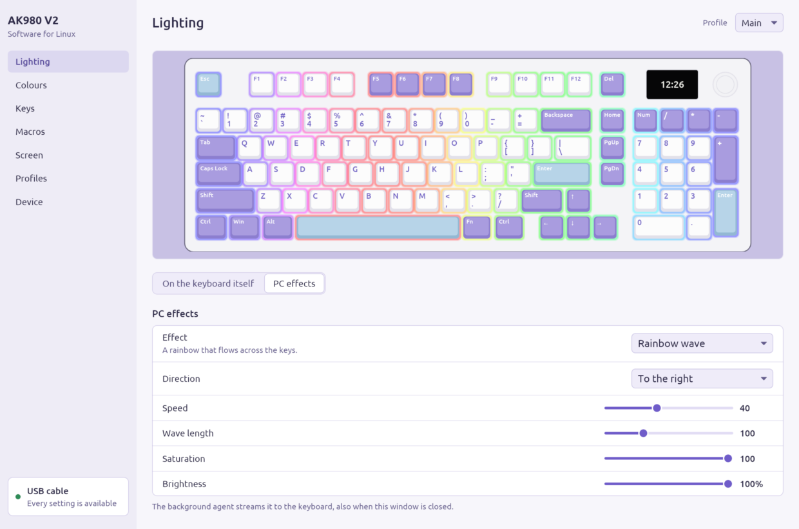
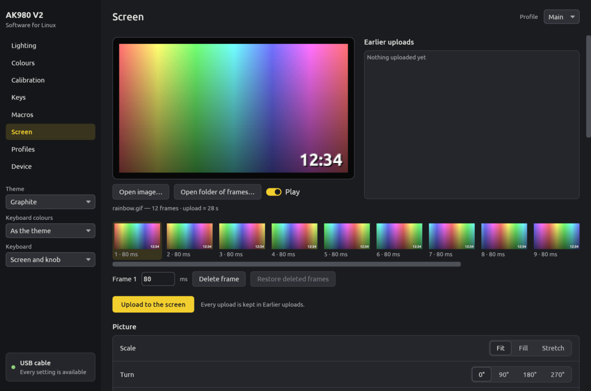
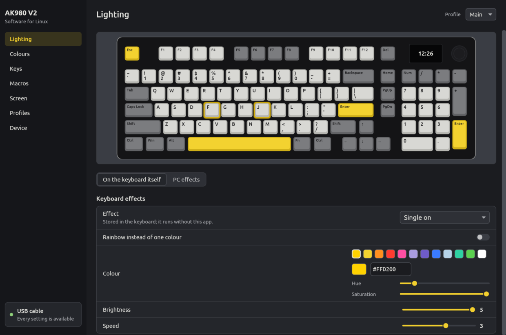
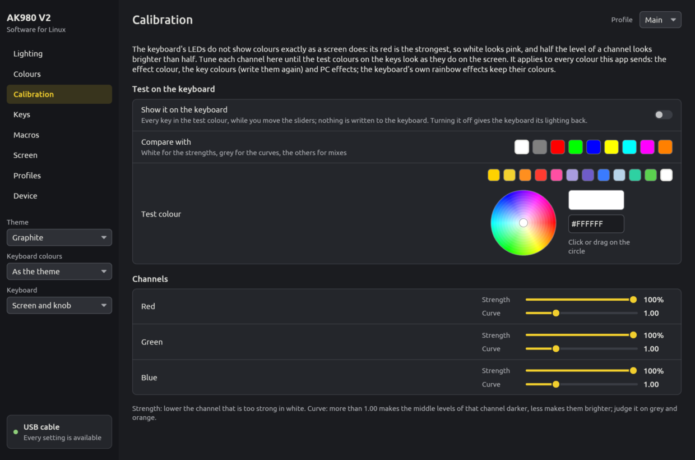
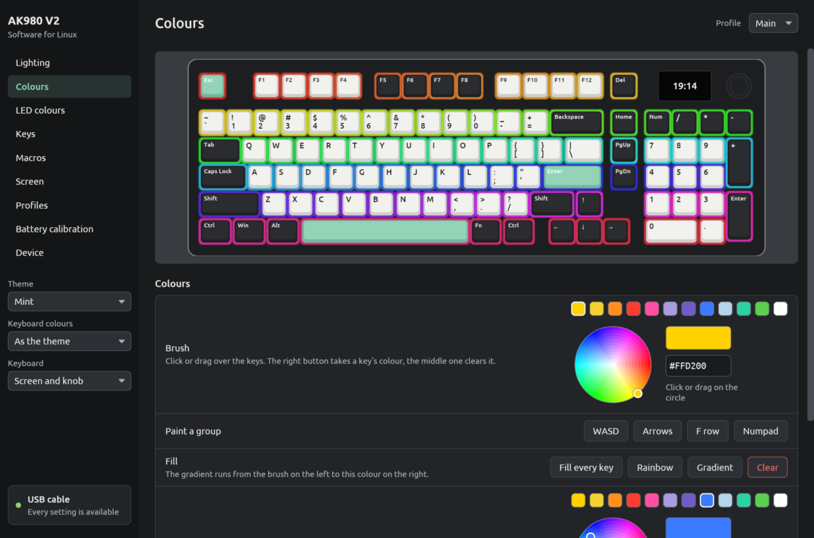
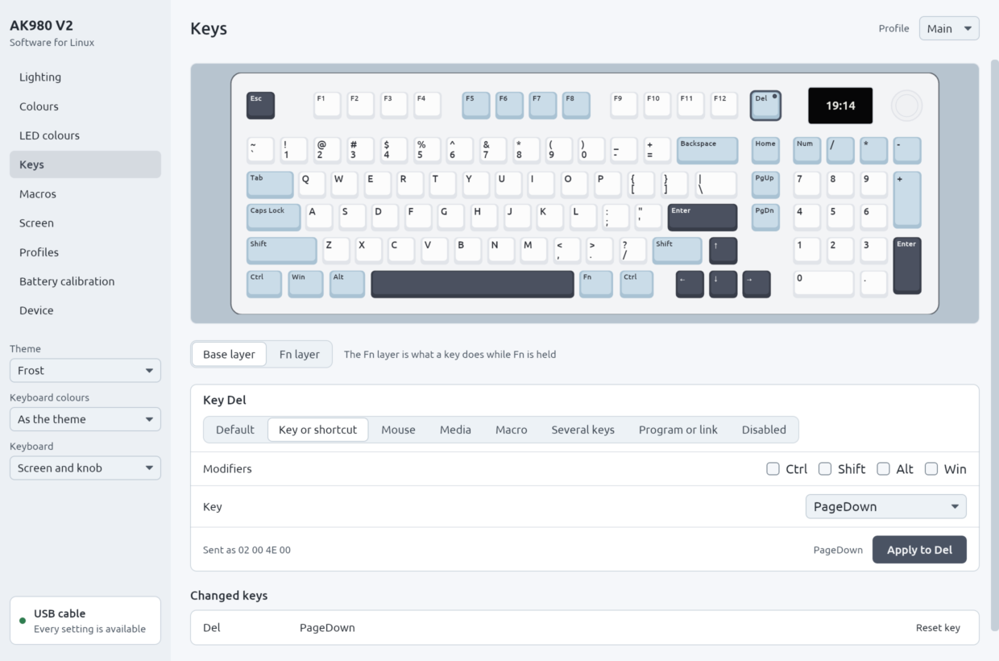
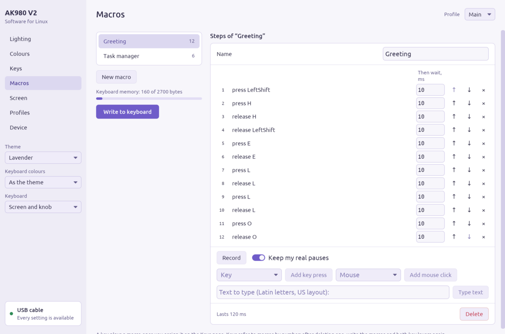
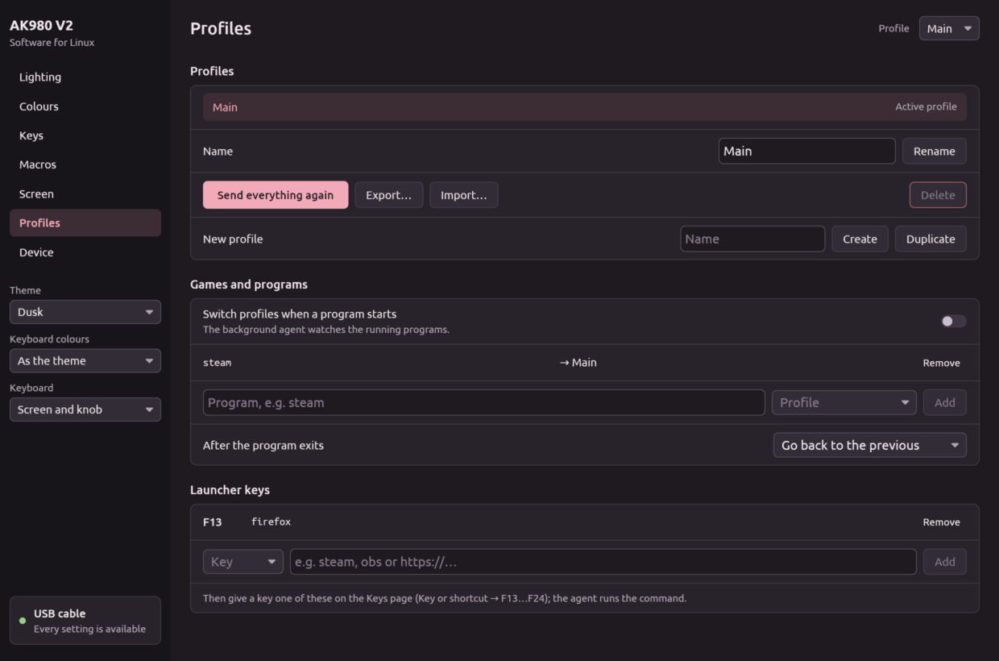
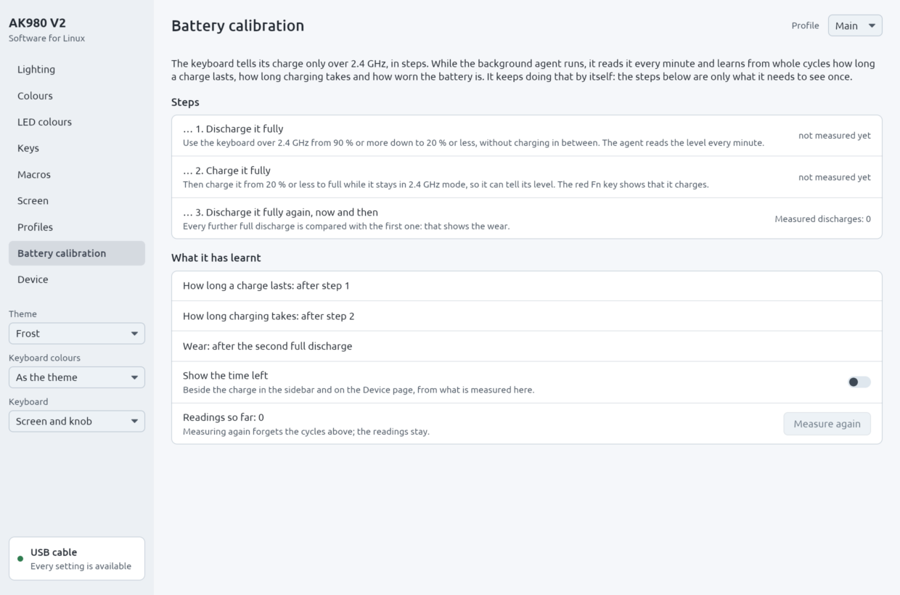
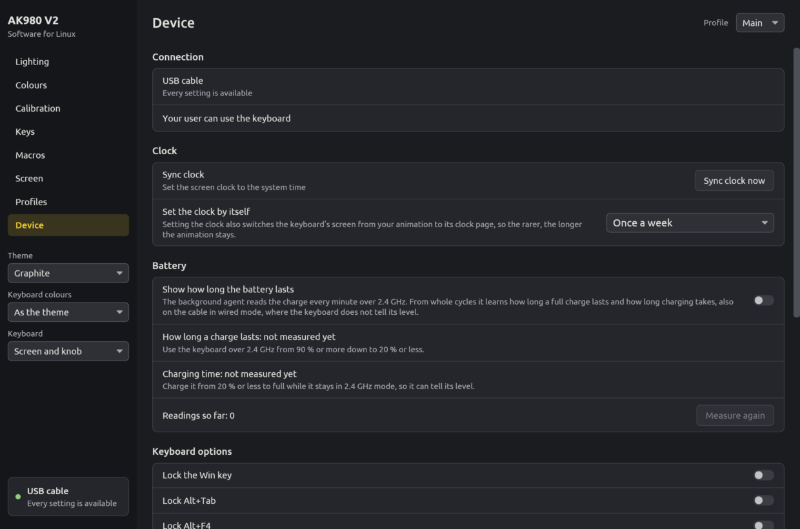

<p align="center">
  <a href="https://standforukraine.com/"></a>
</p>

<p align="center">
  <b>Ukraine is defending itself against Russia's full-scale invasion.</b><br>
  Support the Armed Forces of Ukraine and humanitarian aid through vetted funds and charities:<br>
  <a href="https://standforukraine.com/"><b>standforukraine.com</b></a>
</p>

---

# Ajazz AK980 V2 | Software for Linux

> [!WARNING]
> **This program was written entirely by artificial intelligence.** Its author needed software like
> this for the keyboard but does not have the skills to write it, and so asked Claude, a large
> language model made by Anthropic, to make it. All of its code and documentation were written by
> Claude at the author's request; the author tried it out on their own AK980 V2. Use it at your own
> risk and expect mistakes.

[Українська](README.uk.md) · [Protocol](docs/PROTOCOL.md) · [Design](docs/DESIGN.md) · [Changelog](CHANGELOG.md)

Configuration software for the **AJAZZ AK980 V2** keyboard that runs on Linux. The vendor's driver
only exists for Windows; this app covers what it does and adds what it could not: the screen clock
keeps itself in sync with your system, lighting effects can be computed on the PC (music spectrum,
reactive typing, fire), and profiles switch when a game starts.

Since 0.0.2 the app is written in Rust (the window uses [iced](https://iced.rs)) and checked on a
real AK980 V2 over the 2.4 GHz receiver and over the cable. 0.0.1, the Python version, is outdated:
the project has gone another way, and it is no longer developed.



> Unofficial software, not affiliated with AJAZZ. [docs/PROTOCOL.md](docs/PROTOCOL.md#what-has-been-verified)
> lists which commands were checked on a real AK980 V2 and by whom.

## What it can do

| | USB cable | 2.4 GHz dongle |
|---|---|---|
| Keep the screen clock in sync (on connect, after sleep, at midnight, hourly) | yes | yes |
| GIFs, pictures and frame folders on the 240×135 screen, with a frame editor | yes | no (firmware) |
| 19 lighting effects of the keyboard: colour, rainbow, brightness, speed, direction | yes | no (firmware) |
| Per-key colours, painted on a drawing of the keyboard | yes | no (firmware) |
| Lighting effects computed on the PC, streamed at 30 fps | yes | no (firmware) |
| Key remapping on the base and Fn layers: keys, shortcuts, mouse, media, macros, several keys, programs and links | yes | no (firmware) |
| Up to 100 macros, recorded from the keyboard or typed in | yes | no (firmware) |
| Profiles, switched by hand, by a key or automatically for a game | yes | lighting stays |
| Win, Alt+Tab and Alt+F4 locks, Fn as a switch, sleep timer, key response | yes | no (firmware) |
| Battery level | read off the measured charging | yes |
| How long the charge lasts, charging time, the battery's condition (measured from whole cycles) | yes | yes |

The keyboard only accepts configuration over the cable; the vendor's driver has the same limit.
Over the dongle it takes the time and reports its battery.

PC effects: rainbow wave, colour drift, breathing, starlight, reactive keys (pressed key, ripple or
cross), fire, music spectrum and music pulse, a system monitor (processor load, memory in use or the
processor's temperature as a bar on the number row, F1–F12 or the whole board) and a typing heat
map. Over any of them, Caps Lock and Num Lock can light up while they are on, and the keyboard can
flash when a desktop notification comes (the app only sees that one came, never its text). The
preview in the app runs the same code that drives the keyboard, so what you see is what the keys
show.

### Beyond the vendor's app

Everything here goes through the commands of the vendor's own driver; nothing new is sent to the
keyboard. What the vendor's Windows app does not do:

- lighting computed on the PC: music, typing, the system monitor, the heat map, lock keys and
  notifications over any effect;
- profile keys: a key (say Fn+1, Fn+2) switches to the next or to a given profile, so every profile
  is a layer of its own; profiles also switch by themselves while a game runs;
- program, link and profile keys that keep working with the window closed (the agent handles them);
- running text over a picture, zoom and pan, turning, tones, a hue shift, sharp pixels for pixel
  art, playing backward or there and back, a delay for every frame;
- battery measurements: how long a full charge lasts and how long charging takes, from whole cycles
  the agent has seen, the level while charging on the cable in wired mode, and how the battery ages;
- the 2.4 GHz link record, *Reconnect the receiver*, notifications for a lost link or a low battery,
  and `ak980 status --waybar` for a panel.

## Install

### Arch Linux, Artix and derivatives

```bash
git clone https://github.com/yellowhearth1/ajazz-ak980-v2-linux
cd ajazz-ak980-v2-linux
makepkg -si
```

`makepkg -si` builds the checkout with cargo, runs the tests and installs the package; pacman brings
in what the app needs from your distribution's repositories. Add `-c` (`makepkg -sic`) to delete
the build files afterwards, over a gigabyte of them.

Or take the package already built: each
[release](https://github.com/yellowhearth1/ajazz-ak980-v2-linux/releases) has
`ajazz-ak980-v2-linux-<version>-x86_64.pkg.tar.zst`. Download it, then

```bash
sudo pacman -U ajazz-ak980-v2-linux-*-x86_64.pkg.tar.zst
```

A graphical package installer that opens `.pkg.tar.zst` files (pamac, for one) installs it on a
double click too.

One package serves every init system. The agent starts with your desktop session; a service of
systemd, dinit, OpenRC, runit or s6 is switched on in the app, which writes it for the init system
you have (see [First start](#first-start)). Up to 0.0.3 those services came in packages of their
own (`-dinit`, `-openrc`, `-runit`, `-s6`); the new package replaces them, so pacman asks to remove
them: answer yes, then switch the service on again on the *Device* page.

### AppImage (any distribution)

Download `Ajazz_AK980_V2-<version>-x86_64.AppImage` from the
[releases](https://github.com/yellowhearth1/ajazz-ak980-v2-linux/releases), make it executable and
start it. On first start the app asks once for your password to install the rule that lets your
user talk to the keyboard. `./Ajazz_AK980_V2-*.AppImage time` and every other command work too.
The AppImage holds just the two programs (about 11 MB); the window loads the display libraries of
your system.

### From source, for your user

```bash
./install.sh            # ~/.local, asks for sudo only to install the udev rule
./uninstall.sh
```

Needs Rust 1.88 or newer (`cargo`, from your distribution or [rustup](https://rustup.rs)). The
programs link only to the C runtime libraries; the window finds Wayland or X11 and the GPU driver
at run time and falls back to drawing on the CPU.

### Other distributions (packagers)

```bash
make                                              # cargo build --release --locked
make DESTDIR="$DESTDIR" PREFIX=/usr install       # programs, data, udev rule, systemd units
```

The app writes the service of any other init system when it is switched on; `install-openrc`,
`install-dinit`, `install-runit` and `install-s6` put those in the package instead.

## First start

1. **Access.** Packages install `/usr/lib/udev/rules.d/60-ajazz-ak980.rules`. If the keyboard was
   already plugged in, reconnect it once or press *Allow access*. Without a package, *Allow access*
   (or `ak980 setup`) installs the rule. The rule opens only the interfaces the app talks to: screen
   and commands on the cable, the two vendor interfaces on the receiver. The interfaces that carry
   what you type stay root's, so other programs cannot read your key presses through them.
2. **Background agent.** It keeps the clock right, runs PC effects, switches profiles and handles
   launcher keys. The package starts it with your desktop session. To run it as a service of your
   init system instead, switch it on on the *Device* page, or from a console:

```bash
ak980 service list                  # what your system offers, and what is on
ak980 service enable dinit-user     # for one
```

| Method | What runs | Init system |
|---|---|---|
| `session` | the full agent, with your desktop session (XDG autostart) | any |
| `systemd-user` | the full agent, as your systemd user service | systemd |
| `dinit-user` | the full agent, as a service of your own dinit (from turnstile or userspawn) | dinit |
| `runit-user` | the full agent, under your own runsvdir (from turnstile or userspawn) | runit |
| `system-systemd`, `system-dinit`, `system-openrc`, `system-runit`, `system-s6` | the clock only, system-wide, before anyone logs in too; asks for the root password once | that one |

The app writes the service for the init system you have, with the path to the program, and lets
that init system check it before it is switched on. The package itself installs only the systemd
units.

**A service of this app cannot stop your system from starting.** dinit refuses to start `boot` when
a service it waits for has a description it cannot read, and in a user's `boot` that takes D-Bus and
the sound server down with it. So the app checks every dinit description with the installed dinit's
own checker (`dinit-check`) before writing it, replaces files in one step so they are never half
written, lets the init system's own tool switch the service on (it reads the service first and
refuses a broken one) and takes away what it refused. Our services are only ever soft dependencies
(`waits-for`, `WantedBy`), never in OpenRC's `boot` runlevel, give up restarting after a few
failures where the init system can (systemd, dinit), and a system service only runs a program that
nobody but root can change. The system agent gives up root for `nobody` with the `input` group.

To switch the agent off by hand, from a console:

| Started by | Off |
|---|---|
| the desktop session | `ak980 service disable session`, or delete `~/.config/autostart/ak980-agent.desktop` |
| systemd (user) | `systemctl --user disable --now ak980-agent` |
| dinit (user) | `dinitctl --user disable ak980-agent`; without a running dinit, `rm ~/.config/dinit.d/boot.d/ak980-agent` |
| runit (user) | `rm -r ~/.config/service/ak980-agent` (or the folder your runsvdir watches) |
| systemd (system) | `sudo systemctl disable --now ak980d` |
| dinit (system) | `sudo dinitctl disable ak980d`; from a rescue shell, `rm /etc/dinit.d/boot.d/ak980d` |
| OpenRC | `sudo rc-update del ak980d default` |
| runit | `sudo rm /run/runit/service/ak980d` (Artix: `/etc/runit/runsvdir/default/ak980d`) |
| s6 | `sudo s6-service delete default ak980d-srv && sudo s6-db-reload` |

## The app

Start *Ajazz AK980 V2* from the menu, or `ak980` without arguments. The keyboard is drawn from its
real layout and every page works on it. Deleting a profile or a macro, resetting a layer and
clearing the colours can be undone until the next change.

The look follows the keyboard, and the sidebar holds it, so it is at hand on every page. Five
themes come from colourways of the AK980: *Graphite* (black case, grey caps, yellow Esc, Enter and
space bar), *Lavender* (white case, lavender modifiers, sky-blue accents), *Mint* (black case, white
letters, black modifiers, mint accents), *Dusk* (black case, caps fading from black through grey to
pink) and *Frost* (white case, blue-grey modifiers, dark slate accents and arrows); Catppuccin comes
in its four flavours (Latte, Frappé, Macchiato, Mocha) with any of its 14 accents. The keyboard can
be drawn in any colourway apart from the theme, with its screen and knob or as the AK980 with
Insert, Print Screen, Scroll Lock and Pause in their place (only the drawing changes), and *Match
the theme* picks the theme that goes with it. Every combination is checked for readable contrast
(WCAG AA). The colourway is a choice: the keyboard tells the computer only "SONiX AK980 PRO" and the
same product number in every colour, so there is nothing to detect it from.

Colours are picked on a colour wheel (hue around, saturation outwards), from swatches or as a hex
code.

| | |
|---|---|
|  | **Screen.** Open a GIF, a picture or a folder of numbered frames. Fit, fill or stretch it; adjust brightness, contrast and saturation; change the speed or give every frame the same delay; cut frames or keep every Nth one to fit the 140-frame limit; turn it, zoom into a part and move it, keep sharp pixels for pixel art, change its tone or shift its hues; play it forward, backward or there and back; add a caption, still or running across the screen, with a shadow or an outline. The strip shows every frame with its delay: select one to change its delay or delete it. The preview is the exact 16-bit image the panel will show. Uploading takes about 0.15 s per 4 KiB page. Every upload is kept under *Earlier uploads*, because the keyboard cannot give an animation back. |
|  | **Lighting.** *Keyboard effects* are the 19 effects of the firmware; they stay when the computer is off ("Single on" and "Single off" are shown typing). *PC effects* are computed here and streamed to the keys; they run while the app or the agent runs. Waves that spread from the centre take a centre you move with sliders or by clicking a key. The keyboard's own keys are listed too: Fn + Z switches the AJAZZ logo light by the arrows off and on. |
|  | **LED colours.** How colours come out on the LEDs: per channel a strength (red is the strongest, so white looks pink) and a curve (how mid levels come out), tuned while every key shows a test colour (white, grey, the primaries, mixes or any colour from the wheel). It applies to every colour the app sends. |
|  | **Colours.** Paint keys: left button paints (drag across keys), right button picks a key's colour, middle button clears it. Fill, rainbow, gradient, WASD, arrows, F row and numpad in one click. The colours are stored in the keyboard. |
|  | **Keys.** Click a key, choose what it does on the base layer or while Fn is held: another key or a shortcut, a mouse button or the wheel, a media key, a macro (once, N times, until pressed again, while held), up to three keys at once, a program or a link, another profile, or nothing. *Program or link* sends one of the spare keys F13–F24, which the agent turns into the program, the link or the profile. |
|  | **Macros.** Record from the keyboard with or without your real pauses, type text, add key presses and mouse clicks, edit every pause. A bar shows how much of the keyboard's macro memory is used. Keys refer to macros by number: after deleting one, write the macros and both key layers again (the app moves the keys of the later macros with them). |
|  | **Profiles.** A profile is everything the keyboard holds plus the PC effect. Switch from the header or here; export and import them as files. *Games and programs* switches a profile while a program runs (`cs2`, `eldenring.exe`, …). |
|  | **Battery calibration.** The keyboard tells its charge only over 2.4 GHz. The agent reads it every minute and learns from whole cycles how long a charge lasts, how long charging takes (and so the level on the cable, where the keyboard does not tell it) and how worn the battery is, in percent against the first measured charge. The page shows the steps it needs to see once (a full discharge, a full charge) and what it has learnt. The red Fn key while the keyboard charges is drawn by its firmware. |
|  | **Device.** Keyboard options, the clock and how often the agent sets it, how the agent starts, access, the 2.4 GHz link record and *Reconnect the receiver*, language, notifications. |

**Reminders** (on the *Screen* page, or `ak980 remind`): at a set time on the days you pick, the
agent shows a notification once and makes the keys call for attention for as many minutes as you
like: flashes, a pulse, a band sweeping across, left and right in turn or rainbow flashes, in the
colour you pick, over any lighting; then the keyboard's own lighting comes back. If you ask, the
text also blinks on the screen and your last animation goes back afterwards. The keyboard keeps a
single animation and no known command shows another one without sending it, so that writes the
screen's memory twice each time (about 5 s for the text, about a minute for a 28-frame animation):
keep it for the reminders that matter. The same is why there is no envelope on the screen for
every new message: each one would rewrite the animation twice.

Not there yet: the tray icon of 0.0.1 (switching profiles from the panel). The agent's
notifications (a lost 2.4 GHz link, a low battery, reminders) need `notify-send`.

## Command line

```bash
ak980 status                                 # connection, battery, profile, agent (--json, --waybar)
ak980 battery --show on                      # what whole cycles taught about the battery
ak980 time                                   # set the screen clock now
ak980 time --auto weekly                     # how often the agent sets it: hourly, daily, weekly, manual
ak980 light --balance 78,100,95              # white balance, when white looks pink
ak980 remind add 16:30 Stand up --days 1,2,3,4,5 --minutes 3 --effect sweep
ak980 remind try pulse --color ff7800        # what a reminder looks like on the keys
ak980 lcd ~/Pictures/cat.gif --fit fill      # upload to the screen (kept in ~/.local/share/ak980/history)
ak980 lcd cat.gif --preview out.gif          # only see how it will look
ak980 lcd photo.jpg --text "Hello" --scroll --outline --tone sepia --preview out.gif   # running text
ak980 light rotating --rainbow on            # a keyboard effect
ak980 fx spectrum palette=fire sensitivity=70   # a PC effect (ak980 fx --list)
ak980 custom --all 101820 --wasd ff8f1f      # per-key colours
ak980 remap CapsLock key:ctrl                # remap; --fn for the Fn layer, --dry to see the bytes
ak980 macro add "GG" "text:gg wp" && ak980 remap F12 macro:0
ak980 launch F13 obs && ak980 remap F1 key:F13 --fn
ak980 launch F14 profile:next && ak980 remap '!1' key:F14 --fn   # Fn+1 switches to the next profile
ak980 profile new Gaming --copy && ak980 auto add cs2 Gaming && ak980 auto on
ak980 service enable dinit-user              # how the agent starts
ak980 link                                   # the 2.4 GHz link record
ak980 reconnect                              # re-plug the receiver (asks for your password)
```

`man ak980` and `ak980 <command> --help` have the details. Bash, zsh and fish completions are
installed with the package.

### In a panel

`ak980 status --waybar` prints what a Waybar custom module reads: the battery on 2.4 GHz, `USB` on
the cable, the rest in the tooltip, and the classes `usb`, `24g`, `absent` and `low`.

```json
"custom/ak980": {
    "exec": "ak980 status --waybar",
    "return-type": "json",
    "interval": 60,
    "format": "⌨ {}"
}
```

`ak980 status --json` gives the same for scripts, with the battery estimate when there is one.

## Troubleshooting

**"No access to /dev/hidraw…"** — the udev rule is missing or the keyboard was plugged in before it
was installed. Run `ak980 setup` (or *Allow access*): it installs the rule when needed and applies it
to the connected keyboard. Reconnecting the keyboard works too.

**Updating from 0.0.1.** The 0.0.1 rule also opened the interfaces that carry key presses. The new
one closes them whenever udev applies it: the Arch and Artix packages do that while installing.
Without a package, run `ak980 setup` once; it replaces the old copy in `/etc/udev/rules.d`. To check,
`ak980 list` shows which `/dev/hidrawN` is which interface (`if0`…`if4`), and `ls -l /dev/hidraw*`
should show `crw-------` (root only) on the cable's `if0` and `if1` and the receiver's `if0`–`if2`.
If one is still open, reconnect the keyboard and its receiver once.

**Only the clock works.** The keyboard is in 2.4 GHz or Bluetooth mode. Connect the cable and switch
the keyboard to wired mode; the vendor's driver has the same limit.

**Music effects stay dark.** They record what the PC plays through `parec` (PulseAudio, or PipeWire
with pipewire-pulse) or `pw-record`. Install one of them.

**Reactive effects ignore typing.** Reading key presses needs the `input` group:
`sudo usermod -aG input $USER`, then log in again. Clicking keys in the app still works.

**Keys stop arriving over 2.4 GHz.** Besides the keyboard, the receiver has two vendor interfaces.
Windows and macOS read them all the time; Linux reads an interface only while a program has it open.
Receivers like this one can stop answering on every interface when a report waits unread there, and
the same receiver (`0c45:fefe`) is reported to drop under Linux but not under macOS. The agent keeps
both interfaces open while the receiver is plugged in, so keep it running. The kernel can do the same
on its own: add `usbhid.quirks=0x0c45:0xfefe:0x400` (`HID_QUIRK_ALWAYS_POLL`) to the kernel command
line.

If it happens anyway, *Reconnect the receiver* on the *Device* page (or `ak980 reconnect`) makes the
PC drop the receiver and find it again, as if it had been plugged in anew, so you do not have to
reach for the cable. With notifications on, the agent tells you when the keyboard stops answering.

The agent also records the link in `~/.local/state/ak980/link.log`: once a minute it asks the
keyboard for its battery over 2.4 GHz and writes down every change, and when you switch to the
cable. After a dropout the last lines tell what failed: *did not take the request* means the
receiver stopped answering the PC, *did not answer* means the radio link, and no change at all means
the keyboard was still reachable. Please open an issue with that file and the end of `dmesg`.

Placement matters too: a receiver behind the metal case or next to Wi-Fi gear loses the keyboard.
Put it on a USB extension cable or a front port, and not on the same USB 2.0 hub as an audio
interface or USB microphone. Tools like `powertop --auto-tune` can suspend the receiver; exclude it.

**The screen shows the clock instead of my animation after the computer starts.** Setting the clock
switches the AK980 V2's screen to its clock page, whatever page is sent with it, and the agent used
to set it every time the keyboard connected and every hour. It now sets it once a week by default
(and at once when the time zone changes); *Set the clock by itself* on the *Device* page, or
`ak980 time --auto`, chooses hourly, daily, weekly or only when you ask. The keyboard keeps its own
time in between. Turn the knob in the screen menu (Fn + press the knob) to get the animation back.

**White looks pink.** The keyboard's red LEDs are stronger than its green and blue ones. The
*LED colours* page lowers the strong channels (and sets each channel's curve) for every colour this
app sends (the effect colour, the key colours and PC effects); *Show it on the keyboard* lets you
compare as you move the sliders. On one AK980 V2, red 78 %, green 100 % and blue 95 % looked white.
The keyboard's rainbow effects use their own colours.

**The AJAZZ logo by the arrows keeps glowing.** No command from the computer reaches it. Press
Fn + Z: the keyboard switches it off (and on again with the same keys), and the app's lighting
commands leave it off. The keyboard does not remember it when it is switched off or loses power, so
the logo lights up again then; press Fn + Z once more.

**The Fn key glows red.** The keyboard is charging; its firmware shows that.

## How it works

The keyboard is a SONiX design. Configuration goes through 65-byte feature reports on interface 3
(usage page `0xFF13`), screen data through 4 KiB output reports on interface 2 (`0xFF68`), and the
dongle takes 33-byte output reports on its interface 3 (`0xFF60`). [docs/PROTOCOL.md](docs/PROTOCOL.md)
documents every command this app uses, which of them were checked on the AK980 V2, and what is still
unknown.

Hardware facts worth knowing:

* the real-time stream is `04 20` + 8 packets of `[index R G B]` + `04 02`; it runs up to ~70 fps,
  but reports sent less than ~1 ms apart make the keyboard stall the USB pipe;
* the logo light next to the arrows is not addressable from the PC;
* the keyboard keeps one animation (the slot sent with an upload does not keep a second one), and an
  animation cannot be read back from it;
* every clock packet shows the screen's clock page;
* white (255, 255, 255) looks pink: the red LEDs are the strongest.

## Credits

The wired protocol was reverse engineered in
[donglover69/ak980-studio](https://github.com/donglover69/ak980-studio) (MIT), and the real-time
stream comes from [hcode10/OpenRGB-With-AulaF108Pro-support](https://github.com/hcode10/OpenRGB-With-AulaF108Pro-support)
(the AULA F108 Pro shares the AK980's firmware). This project ports both to Linux, verifies them on
an AK980 V2 and builds the rest on top. The interface uses the Ubuntu font family (Ubuntu Font
Licence 1.0) and the [Catppuccin](https://github.com/catppuccin/catppuccin) palette (MIT); the colour roles of the
Graphite and Lavender themes follow its style guide.

## License

MIT, see [LICENSE](LICENSE). Bundled fonts: Ubuntu Font Licence 1.0, see
[ak980/data/fonts/UFL.txt](ak980/data/fonts/UFL.txt).
