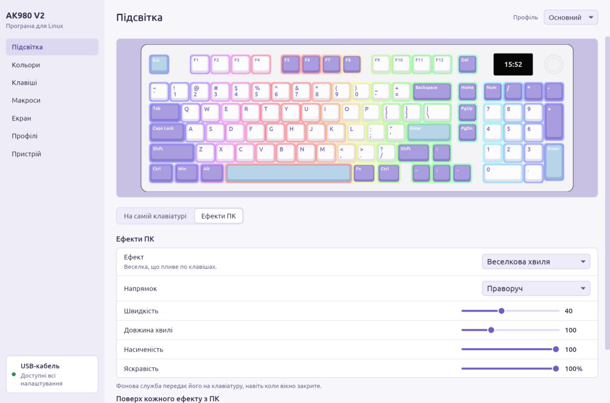
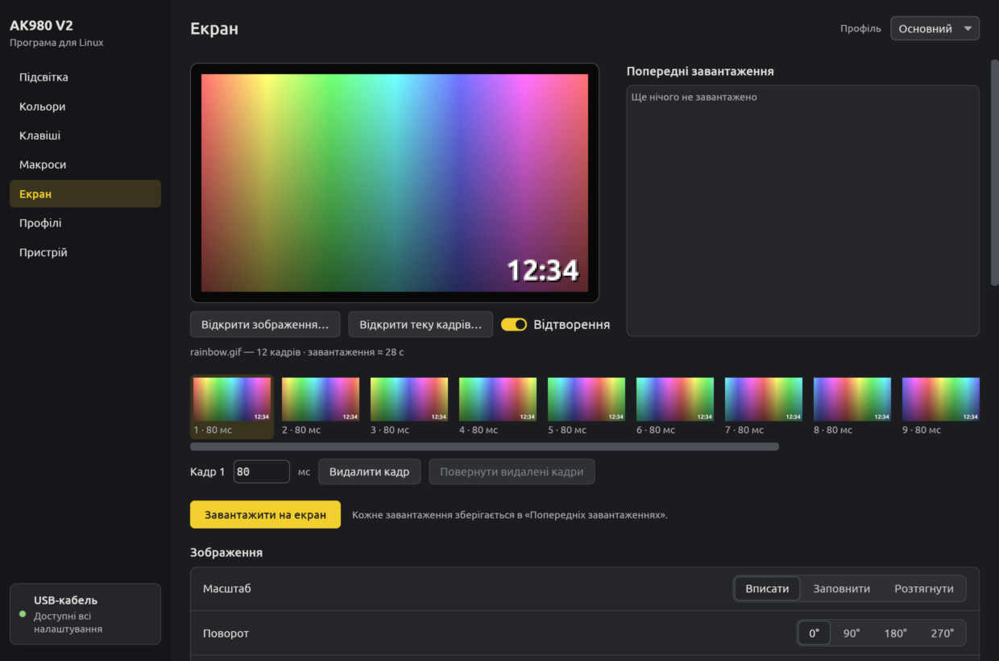
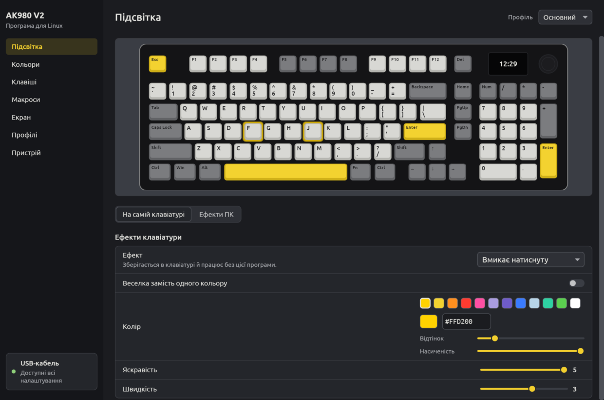
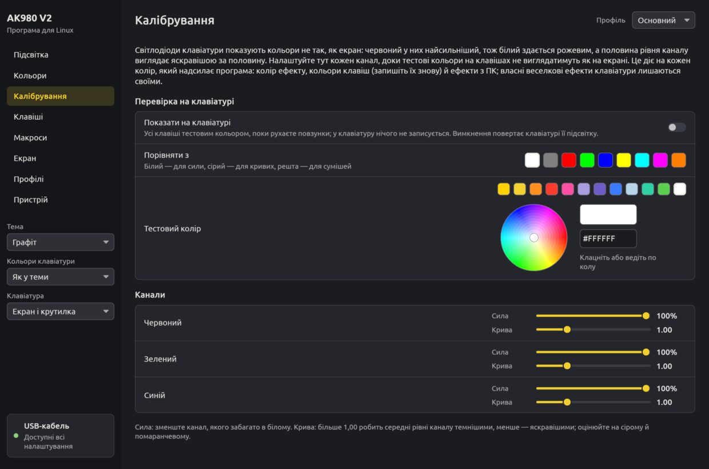
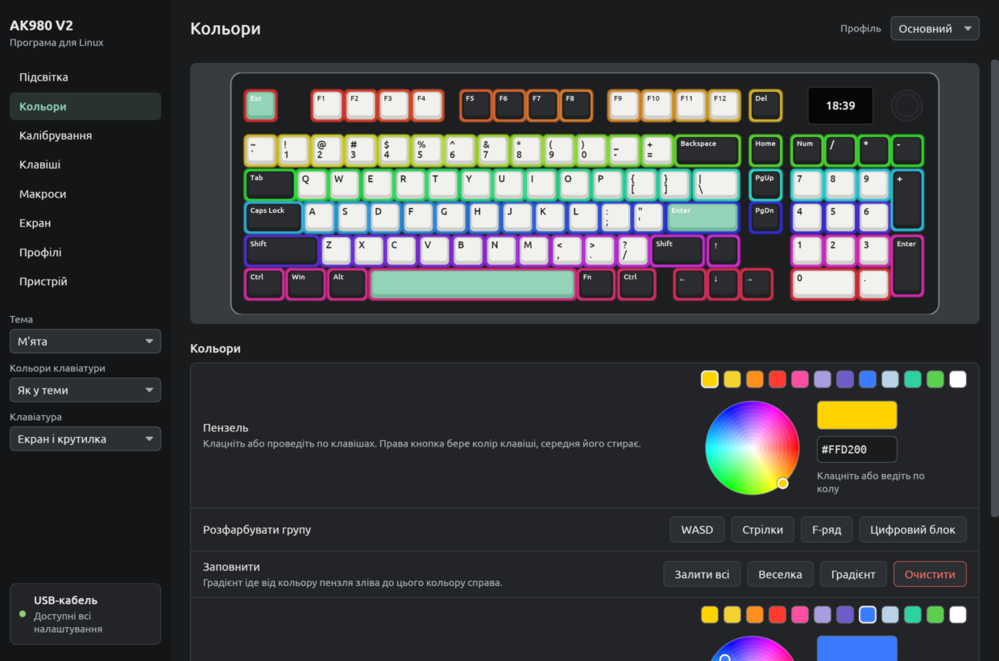
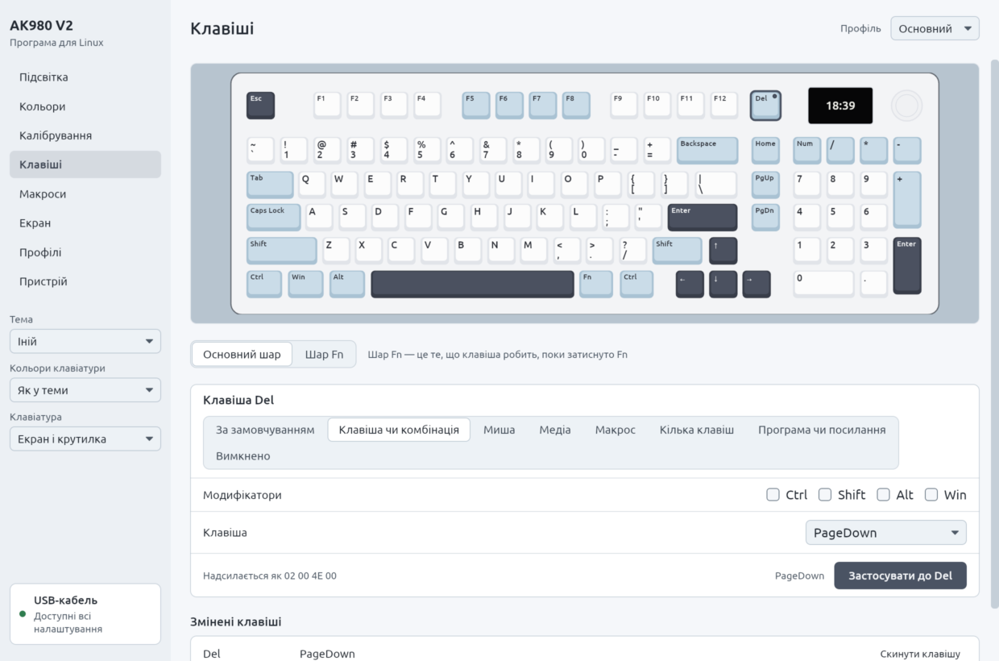
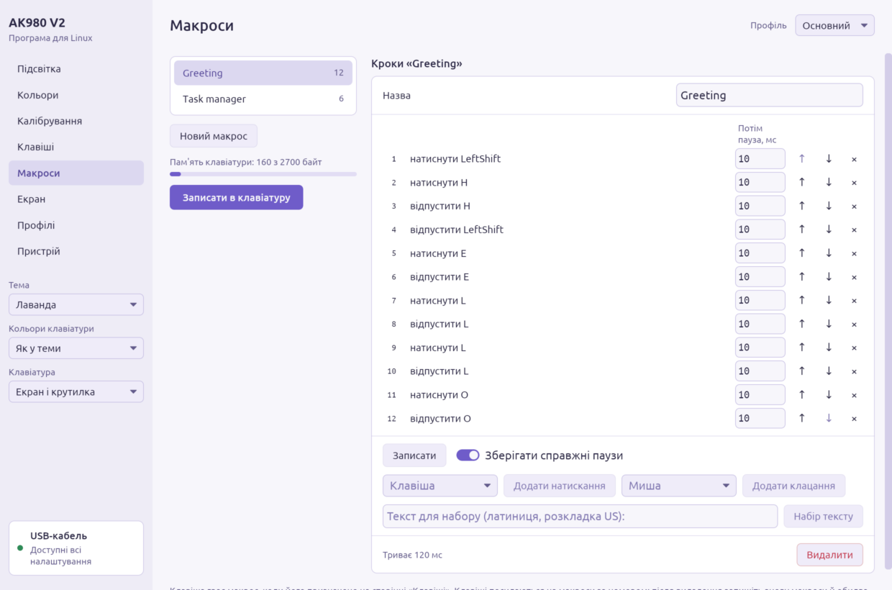
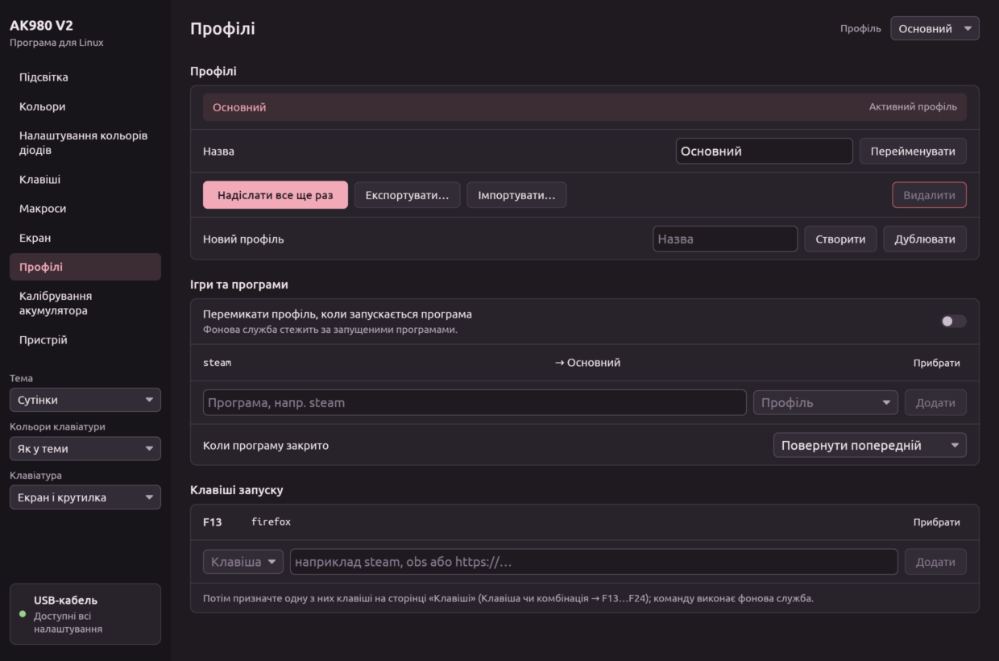
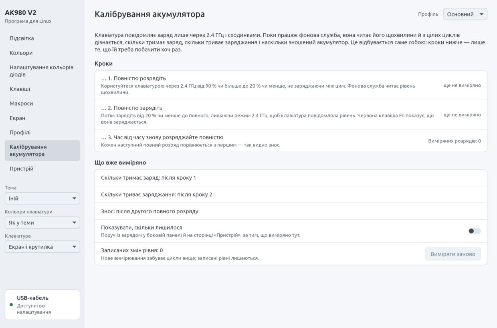
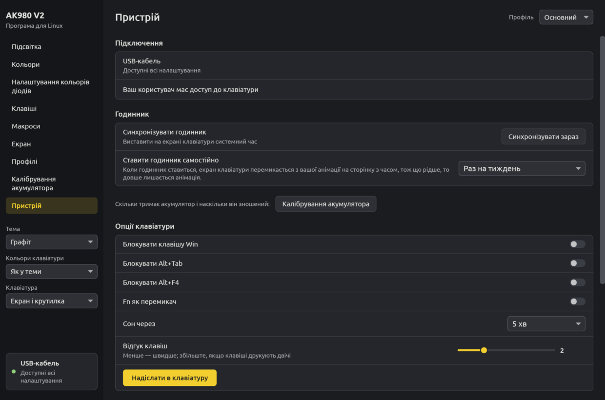

<p align="center">
  <a href="https://standforukraine.com/"></a>
</p>

<p align="center">
  <b>Україна захищається від повномасштабного вторгнення Росії.</b><br>
  Підтримай Збройні сили України й гуманітарну допомогу через перевірені фонди:<br>
  <a href="https://standforukraine.com/"><b>standforukraine.com</b></a>
</p>

---

<div align="center">

# Ajazz AK980 V2 | Software for Linux

<a href="https://www.rust-lang.org"></a>
<a href="https://iced.rs"></a>
<a href="https://artixlinux.org"></a>


<a href="LICENSE"></a>
<a href="README.md"></a>

<a href="https://github.com/YellowHearth1/ajazz-ak980-v2-linux/pulls"></a>

<a href="https://github.com/YellowHearth1/ajazz-ak980-v2-linux/actions/workflows/ci.yml"></a>
<a href="https://github.com/YellowHearth1/ajazz-ak980-v2-linux/releases/latest"></a>


</div>

> [!WARNING]
> **Цю програму повністю написав штучний інтелект.** Її авторові потрібна була така програма для
> клавіатури, але навичок, щоб написати її самому, в автора немає, тож автор попросив велику мовну
> модель Claude від Anthropic зробити її. Увесь код і документацію написав Claude на прохання автора;
> автор перевіряв програму на своїй AK980 V2. Користуйтеся на власний ризик і будьте готові до
> помилок.

[English](README.md) · [Протокол](docs/PROTOCOL.md) · [Дизайн](docs/DESIGN.md) · [Зміни](CHANGELOG.md)

Програма для налаштування клавіатури **AJAZZ AK980 V2** у Linux. Драйвер виробника існує лише для
Windows. Ця програма вміє все, що вміє він, і робить те, чого він не міг: годинник на екрані сам
звіряється з системою, ефекти підсвітки може рахувати комп'ютер (спектр музики, відгук на набір,
вогонь), а профілі перемикаються, коли запускається гра.

З версії 0.0.2 програма написана на Rust (вікно на [iced](https://iced.rs)) і перевірена на
справжній AK980 V2 через приймач 2.4 ГГц і через кабель. 0.0.1, версія на Python, застаріла: проєкт
пішов іншим шляхом, і її більше не розвивають.



> Неофіційна програма, не пов'язана з AJAZZ. У [docs/PROTOCOL.md](docs/PROTOCOL.md#what-has-been-verified)
> перелічено, які команди і ким перевірено на справжній AK980 V2.

## Що вміє

| | USB-кабель | Донгл 2.4 ГГц |
|---|---|---|
| Тримати годинник на екрані точним (при підключенні, після сну, опівночі, щогодини) | так | так |
| GIF, зображення й теки кадрів на екрані 240×135, з редактором кадрів | так | ні (прошивка) |
| 19 ефектів підсвітки клавіатури: колір, веселка, яскравість, швидкість, напрямок | так | ні (прошивка) |
| Кольори окремих клавіш, намальовані просто на клавіатурі | так | ні (прошивка) |
| Ефекти підсвітки, які рахує комп'ютер, 30 кадрів/с | так | ні (прошивка) |
| Перепризначення клавіш на основному шарі та шарі Fn: клавіші, комбінації, миша, медіа, макроси, кілька клавіш, програми й посилання | так | ні (прошивка) |
| До 100 макросів, записаних із клавіатури або набраних | так | ні (прошивка) |
| Профілі: вручну, клавішею або автоматично для гри | так | підсвітка лишається |
| Блокування Win, Alt+Tab і Alt+F4, Fn як перемикач, таймер сну, відгук клавіш | так | ні (прошивка) |
| Заряд батареї | за виміряною кривою заряджання | так |
| На скільки вистачить заряду, час заряджання, стан акумулятора (з виміряних повних циклів) | так | так |

Налаштування клавіатура приймає лише по кабелю, і драйвер виробника має те саме обмеження. Через
донгл вона приймає час і повідомляє заряд батареї.

Ефекти ПК: веселкова хвиля, дрейф кольорів, дихання, зоряне небо, відгук на натискання (клавіша,
хвиля або хрест), вогонь, спектр музики та пульс музики, монітор системи (навантаження чи
температура процесора або зайнята пам'ять смужкою на ряду цифр, F1–F12 чи всій клавіатурі) і
теплова карта набору. Поверх будь-якого з них Caps Lock і Num Lock можуть світитися, поки ввімкнені,
а клавіатура — спалахувати, коли приходить сповіщення (програма бачить лише, що воно прийшло, а його
текст — ніколи). Прев'ю в програмі виконує той самий код, що й керує клавіатурою, тож бачите саме
те, що світиться на клавішах.

### Чого не вміє програма виробника

Усе тут іде командами власного драйвера виробника; нових команд клавіатура не отримує. Чого немає у
програмі виробника для Windows:

- підсвітки, яку рахує комп'ютер: музика, набір, монітор системи, теплова карта, клавіші Lock і
  сповіщення поверх будь-якого ефекту;
- клавіш профілів: клавіша (скажімо, Fn+1, Fn+2) перемикає на наступний чи названий профіль, тож
  кожен профіль стає окремим шаром; профілі й самі перемикаються, поки працює гра;
- клавіш програм, посилань і профілів, що працюють і з закритим вікном (їх обробляє фонова служба);
- біжучого рядка поверх картинки, збільшення й зсуву, повороту, тонів, зсуву відтінків, чітких
  пікселів для піксель-арту, програвання назад чи туди й назад, затримки для кожного кадру;
- вимірювань акумулятора: на скільки вистачає повного заряду й скільки триває заряджання — з
  повних циклів, які бачила фонова служба, рівня під час заряджання на кабелі в дротовому режимі та
  того, як акумулятор старіє;
- журналу зв'язку 2.4 ГГц, *Перепідключити ресівер*, сповіщень про втрачений зв'язок чи низький
  заряд і `ak980 status --waybar` для панелі.

## Встановлення

### Arch Linux, Artix і похідні

```bash
git clone https://github.com/yellowhearth1/ajazz-ak980-v2-linux
cd ajazz-ak980-v2-linux
makepkg -si
```

`makepkg -si` збирає цю копію репозиторію через cargo, проганяє тести й встановлює пакет; усе
потрібне програмі pacman доставить зі сховищ вашого дистрибутива. Додайте `-c` (`makepkg -sic`), щоб
після збірки видалити її файли, а їх понад гігабайт.

Або візьміть уже зібраний пакет: у кожному
[релізі](https://github.com/yellowhearth1/ajazz-ak980-v2-linux/releases) є
`ajazz-ak980-v2-linux-<версія>-x86_64.pkg.tar.zst`. Завантажте його, а тоді

```bash
sudo pacman -U ajazz-ak980-v2-linux-*-x86_64.pkg.tar.zst
```

Графічний встановлювач, що відкриває файли `.pkg.tar.zst` (наприклад, pamac), встановить пакет і
подвійним клацанням.

Один пакет для всіх init-систем. Фонова служба запускається разом із сеансом робочого столу, а
службу systemd, dinit, OpenRC, runit чи s6 вмикає сама програма й пише її під ту init-систему, яка у
вас є (див. [Перший запуск](#перший-запуск)). До 0.0.3 ці служби були окремими пакетами (`-dinit`,
`-openrc`, `-runit`, `-s6`); новий пакет їх замінює, тож pacman запитає, чи їх видалити: відповідайте
«так», а потім знову увімкніть службу на сторінці *Пристрій*.

### AppImage (будь-який дистрибутив)

Завантажте `Ajazz_AK980_V2-<версія>-x86_64.AppImage` зі сторінки
[релізів](https://github.com/yellowhearth1/ajazz-ak980-v2-linux/releases), зробіть файл виконуваним і
запустіть. При першому запуску програма один раз попросить пароль, щоб встановити правило доступу
до клавіатури. `./Ajazz_AK980_V2-*.AppImage time` та всі інші команди теж працюють.
В AppImage лише дві програми (близько 11 МБ); бібліотеки для показу вікна беруться з вашої системи.

### З вихідного коду, для свого користувача

```bash
./install.sh            # у ~/.local; sudo знадобиться лише для udev-правила
./uninstall.sh
```

Потрібен Rust 1.88 або новіший (`cargo` з вашого дистрибутива чи [rustup](https://rustup.rs)).
Програми залежать лише від бібліотек виконання C; вікно саме знаходить Wayland чи X11 і драйвер
відеокарти, а без нього малює процесором.

### Інші дистрибутиви (для мейнтейнерів)

```bash
make                                              # cargo build --release --locked
make DESTDIR="$DESTDIR" PREFIX=/usr install       # програми, дані, правило udev, юніти systemd
```

Служби інших init-систем програма пише сама, коли їх вмикають; `install-openrc`, `install-dinit`,
`install-runit` і `install-s6` натомість кладуть їх у пакет.

## Перший запуск

1. **Доступ.** Пакети встановлюють `/usr/lib/udev/rules.d/60-ajazz-ak980.rules`. Якщо клавіатура вже
   була підключена, перепідключіть її один раз або натисніть *Надати доступ*. Без пакета *Надати
   доступ* (або `ak980 setup`) встановить правило. Правило відкриває лише ті інтерфейси, з якими
   працює програма: екран і команди на кабелі, два службові інтерфейси на приймачі. Інтерфейси,
   якими йде набраний текст, лишаються за root, тож інші програми не прочитають через них ваші
   натискання.
2. **Фонова служба.** Вона тримає годинник точним, запускає ефекти ПК, перемикає профілі та
   обробляє клавіші запуску. Пакет запускає її разом із сеансом робочого столу. Щоб натомість вона
   працювала як служба вашої init-системи, увімкніть її на сторінці *Пристрій* або з консолі:

```bash
ak980 service list                  # що є у вашій системі і що вже ввімкнено
ak980 service enable dinit-user     # наприклад
```

| Спосіб | Що працює | Init-система |
|---|---|---|
| `session` | повна служба, разом із сеансом робочого столу (XDG-автозапуск) | будь-яка |
| `systemd-user` | повна служба, як ваша служба користувача systemd | systemd |
| `dinit-user` | повна служба, як служба вашого власного dinit (від turnstile чи userspawn) | dinit |
| `runit-user` | повна служба, під вашим власним runsvdir (від turnstile чи userspawn) | runit |
| `system-systemd`, `system-dinit`, `system-openrc`, `system-runit`, `system-s6` | лише годинник, для всієї системи, ще й до входу; один раз попросить пароль root | саме ця |

Програма пише службу під вашу init-систему, з шляхом до програми, і дає самій init-системі перевірити
її, перш ніж та ввімкнеться. Сам пакет встановлює лише юніти systemd.

**Служба цієї програми не може завадити системі запуститися.** dinit не запускає `boot`, якщо в
служби, на яку він чекає, опис, який він не може прочитати; у користувацькому `boot` разом із нею
падають D-Bus і звук. Тому програма перевіряє кожен опис для dinit його ж перевіряльником
(`dinit-check`) ще до запису, замінює файли одним кроком (вони ніколи не лишаються записаними
наполовину), вмикає службу власним інструментом init-системи (він спершу читає опис і відмовляє
битому) і прибирає те, від чого він відмовився. Наші служби — лише м'які залежності (`waits-for`,
`WantedBy`), ніколи не в рівні `boot` OpenRC, перестають перезапускатися після кількох збоїв там, де
init-система це вміє (systemd, dinit), а системна служба запускає лише програму, яку не може змінити
ніхто, крім root. Системний агент одразу відмовляється від root і працює як `nobody` з групою `input`.

Як вимкнути фонову службу вручну, з консолі:

| Чим запускається | Вимкнути |
|---|---|
| сеанс робочого столу | `ak980 service disable session` або видаліть `~/.config/autostart/ak980-agent.desktop` |
| systemd (користувача) | `systemctl --user disable --now ak980-agent` |
| dinit (користувача) | `dinitctl --user disable ak980-agent`; якщо dinit не запущено, `rm ~/.config/dinit.d/boot.d/ak980-agent` |
| runit (користувача) | `rm -r ~/.config/service/ak980-agent` (або тека, яку стежить ваш runsvdir) |
| systemd (системна) | `sudo systemctl disable --now ak980d` |
| dinit (системна) | `sudo dinitctl disable ak980d`; з аварійної оболонки — `rm /etc/dinit.d/boot.d/ak980d` |
| OpenRC | `sudo rc-update del ak980d default` |
| runit | `sudo rm /run/runit/service/ak980d` (Artix: `/etc/runit/runsvdir/default/ak980d`) |
| s6 | `sudo s6-service delete default ak980d-srv && sudo s6-db-reload` |

## Програма

Запустіть *Ajazz AK980 V2* з меню або `ak980` без аргументів. Клавіатуру намальовано за її справжньою
розкладкою, і кожна сторінка працює з нею. Видалення профілю чи макросу, скидання шару й очищення
кольорів можна повернути, доки ви не зробили наступну зміну.

Вигляд іде від клавіатури й лежить у боковій панелі, тож він під рукою на кожній сторінці. П'ять
тем узято з розфарбовок AK980: *Графіт* (чорний корпус, сірі клавіші, жовті Esc, Enter і пробіл),
*Лаванда* (білий корпус, лавандові модифікатори, блакитні акценти), *М'ята* (чорний корпус, білі
букви, чорні модифікатори, м'ятні акценти), *Сутінки* (чорний корпус, клавіші від чорних через сірі
до рожевих) та *Іній* (білий корпус, блакитно-сірі модифікатори, темно-сланцеві акценти й стрілки);
Catppuccin є в усіх чотирьох смаках (Latte, Frappé, Macchiato, Mocha) з будь-яким із 14 акцентів.
Клавіатуру можна малювати в будь-якій розфарбовці окремо від теми, з екраном і крутилкою або як
AK980 з Insert, Print Screen, Scroll Lock і Pause на їхньому місці (змінюється лише малюнок), а
*Підібрати тему* обере тему до неї. Кожне поєднання перевірено на читабельний контраст (WCAG AA).
Розфарбовку обирають вручну: клавіатура повідомляє комп'ютеру лише «SONiX AK980 PRO» й той самий
номер продукту в усіх кольорах, тож визначити її нема з чого.

Кольори обирають на колірному колі (відтінок по колу, насиченість від центру), зі зразків або
шістнадцятковим кодом.

| | |
|---|---|
|  | **Екран.** Відкрийте GIF, зображення або теку пронумерованих кадрів. Впишіть, заповніть чи розтягніть; підкрутіть яскравість, контраст і насиченість; змініть швидкість або дайте всім кадрам однакову затримку; обріжте кадри чи беріть кожен N-й, щоб вміститися в 140; поверніть, збільште частину й посуньте її, залиште чіткі пікселі для піксель-арту, змініть тон чи зсуньте відтінки; програвайте вперед, назад чи туди й назад; додайте напис — нерухомий чи біжучим рядком, з тінню чи облямівкою. Стрічка показує всі кадри з затримками: виберіть кадр, щоб змінити його затримку чи видалити. Прев'ю — це точне 16-бітне зображення, яке покаже панель. Завантаження триває близько 0,15 с на 4 КіБ. Кожне завантаження зберігається в *Попередніх завантаженнях*, бо віддати анімацію назад клавіатура не може. |
|  | **Підсвітка.** *Ефекти клавіатури* — це 19 ефектів прошивки; вони лишаються й без комп'ютера («Single on» і «Single off» показано під час набору). *Ефекти ПК* рахуються тут і транслюються на клавіші, поки працює програма або фонова служба. Хвилям, що розходяться від центру, центр можна пересунути повзунками або клацанням по клавіші. Тут же перелічено власні клавіші клавіатури: Fn + Z вимикає й вмикає підсвітку логотипа AJAZZ біля стрілок. |
|  | **Налаштування кольорів діодів.** Як кольори виходять на світлодіодах: для кожного каналу сила (червоний найсильніший, тож білий рожевий) і крива (як виходять середні рівні), налаштовуються, поки всі клавіші світяться тестовим кольором (білий, сірий, основні, суміші чи будь-який з кола). Діє на кожен колір, який надсилає програма. |
|  | **Кольори.** Малюйте по клавішах: ліва кнопка фарбує (можна вести), права бере колір клавіші, середня стирає. Заливка, веселка, градієнт, WASD, стрілки, F-ряд і цифровий блок одним кліком. Кольори зберігаються в клавіатурі. |
|  | **Клавіші.** Клацніть клавішу й оберіть, що вона робить на основному шарі чи з затиснутим Fn: інша клавіша чи комбінація, кнопка або коліщатко миші, медіаклавіша, макрос (один раз, N разів, до повторного натискання, поки утримується), до трьох клавіш разом, програма чи посилання, інший профіль, або нічого. *Програма чи посилання* надсилає одну з вільних клавіш F13–F24, яку фонова служба перетворює на запуск програми, посилання чи перемикання профілю. |
|  | **Макроси.** Записуйте з клавіатури зі справжніми паузами або без них, набирайте текст, додавайте натискання клавіш і кліки миші, редагуйте кожну паузу. Смужка показує, скільки пам'яті макросів клавіатури зайнято. Клавіші посилаються на макроси за номером: після видалення запишіть знову макроси й обидва шари (програма зсуває клавіші наступних макросів разом із ними). |
|  | **Профілі.** Профіль — це все, що тримає клавіатура, плюс ефект ПК. Перемикайте з шапки або тут; експортуйте й імпортуйте файлами. *Ігри та програми* вмикає профіль, поки запущена програма (`cs2`, `eldenring.exe`, …). |
|  | **Калібрування акумулятора.** Клавіатура повідомляє заряд лише через 2.4 ГГц. Фонова служба читає його щохвилини й з цілих циклів дізнається, скільки тримає заряд, скільки триває заряджання (а отже, і рівень на кабелі, де клавіатура його не повідомляє) та наскільки зношений акумулятор — у відсотках проти першого виміряного заряду. Сторінка показує кроки, які їй треба побачити хоч раз (повний розряд, повний заряд), і що вже виміряно. Червону клавішу Fn під час заряджання малює прошивка клавіатури. |
|  | **Пристрій.** Опції клавіатури, годинник і як часто його ставить фонова служба, запуск фонової служби, доступ, журнал зв'язку 2.4 ГГц і *Перепідключити ресівер*, мова, сповіщення. |

**Нагадування** (на сторінці *Екран* або `ak980 remind`): у заданий час у вибрані дні фонова
служба один раз показує сповіщення, а клавіші кличуть до уваги стільки хвилин, скільки скажете:
спалахи, пульсація, смуга туди й назад, ліва й права половини по черзі або веселкові спалахи,
вибраним кольором, поверх будь-якої підсвітки; потім повертається звичайна підсвітка. На прохання
текст ще й блимає на екрані, а після нього повертається ваша остання анімація. Клавіатура тримає
лише одну анімацію, і жодна відома команда не показує іншу без надсилання, тож щоразу це двічі
перезаписує пам'ять екрана (близько 5 с на текст і приблизно хвилину на анімацію з 28 кадрів):
вмикайте це для справді важливих нагадувань. З тієї ж причини немає конверта на екрані на кожне
нове повідомлення: кожне двічі переписувало б анімацію.

Чого ще немає: значка в треї з 0.0.1 (перемикання профілів з панелі). Сповіщенням фонової служби
(зник зв'язок 2.4 ГГц, низький заряд, нагадування) потрібен `notify-send`.

## Командний рядок

```bash
ak980 status                                 # підключення, батарея, профіль, служба (--json, --waybar)
ak980 battery --show on                      # що повні цикли показали про акумулятор
ak980 time                                   # виставити час на екрані зараз
ak980 time --auto weekly                     # як часто ставить служба: hourly, daily, weekly, manual
ak980 light --balance 78,100,95              # баланс білого, якщо білий рожевий
ak980 remind add 16:30 Встати --days 1,2,3,4,5 --minutes 3 --effect sweep
ak980 remind try pulse --color ff7800        # як нагадування виглядає на клавішах
ak980 lcd ~/Зображення/кіт.gif --fit fill    # на екран (копія в ~/.local/share/ak980/history)
ak980 lcd кіт.gif --preview out.gif          # лише подивитись, як це виглядатиме
ak980 lcd фото.jpg --text "Привіт" --scroll --outline --tone sepia --preview out.gif   # біжучий рядок
ak980 light rotating --rainbow on            # ефект клавіатури
ak980 fx spectrum palette=fire sensitivity=70   # ефект ПК (ak980 fx --list)
ak980 custom --all 101820 --wasd ff8f1f      # кольори клавіш
ak980 remap CapsLock key:ctrl                # перепризначення; --fn для шару Fn, --dry щоб побачити байти
ak980 macro add "GG" "text:gg wp" && ak980 remap F12 macro:0
ak980 launch F13 obs && ak980 remap F1 key:F13 --fn
ak980 launch F14 profile:next && ak980 remap '!1' key:F14 --fn   # Fn+1 — на наступний профіль
ak980 profile new Gaming --copy && ak980 auto add cs2 Gaming && ak980 auto on
ak980 service enable dinit-user              # як запускати фонову службу
ak980 link                                   # журнал зв'язку 2.4 ГГц
ak980 reconnect                              # перепідключити приймач (спитає пароль)
```

Подробиці: `man ak980` і `ak980 <команда> --help`. Пакет встановлює автодоповнення для bash, zsh і fish.

### На панелі

`ak980 status --waybar` друкує те, що читає власний модуль Waybar: заряд у режимі 2.4 ГГц, `USB` на
кабелі, решту в підказці, і класи `usb`, `24g`, `absent` та `low`.

```json
"custom/ak980": {
    "exec": "ak980 status --waybar",
    "return-type": "json",
    "interval": 60,
    "format": "⌨ {}"
}
```

`ak980 status --json` дає те саме для скриптів, разом з оцінкою заряду, коли вона є.

## Якщо щось не так

**«Немає доступу до /dev/hidraw…»** — немає udev-правила, або клавіатуру підключили раніше, ніж
його встановили. Виконайте `ak980 setup` (або *Надати доступ*): правило встановиться, якщо його ще
немає, і застосується до підключеної клавіатури. Перепідключення клавіатури теж допомагає.

**Оновлення з 0.0.1.** Правило 0.0.1 відкривало й інтерфейси, якими йдуть натискання. Нове правило
закриває їх щоразу, коли udev його застосовує: пакети для Arch і Artix роблять це під час
встановлення. Без пакета виконайте один раз `ak980 setup`: він замінить стару копію в
`/etc/udev/rules.d`. Щоб перевірити, `ak980 list` покаже, який `/dev/hidrawN` є яким інтерфейсом
(`if0`…`if4`), а `ls -l /dev/hidraw*` має показати `crw-------` (лише root) на `if0` і `if1` кабелю та
`if0`–`if2` приймача. Якщо якийсь іще відкритий, перепідключіть клавіатуру та її приймач один раз.

**Працює лише годинник.** Клавіатура в режимі 2.4 ГГц або Bluetooth. Підключіть кабель і перемкніть
клавіатуру в дротовий режим; драйвер виробника має те саме обмеження.

**Музичні ефекти темні.** Вони записують звук комп'ютера через `parec` (PulseAudio або PipeWire з
pipewire-pulse) чи `pw-record`. Встановіть одну з цих програм.

**Відгук на натискання не реагує.** Для читання натискань потрібна група `input`:
`sudo usermod -aG input $USER`, потім перезайдіть у систему. Клацання по клавішах у програмі працюють і так.

**Клавіші перестають доходити через 2.4 ГГц.** Крім клавіатури, у ресівера є два службові інтерфейси
виробника. Windows і macOS читають їх постійно, а Linux читає інтерфейс лише тоді, коли його відкрила
якась програма. Ресівери такого типу можуть замовкнути на всіх інтерфейсах, якщо там чекає
непрочитаний звіт. Про той самий ресівер (`0c45:fefe`) пишуть, що під Linux він відпадає, а під macOS
ні. Агент тримає обидва інтерфейси відкритими, поки ресівер підключений, тож не вимикайте його. Те
саме може робити й ядро: додайте `usbhid.quirks=0x0c45:0xfefe:0x400` (`HID_QUIRK_ALWAYS_POLL`) до
параметрів ядра.

Якщо обрив усе ж стався, *Перепідключити ресівер* на сторінці *Пристрій* (або `ak980 reconnect`)
змусить комп'ютер відпустити приймач і знайти знову, ніби його щойно вставили, тож тягнутися по
кабель не доведеться. Зі ввімкненими сповіщеннями фонова служба скаже, коли клавіатура перестала
відповідати.

Агент також веде журнал зв'язку `~/.local/state/ak980/link.log`: щохвилини питає в клавіатури заряд
через 2.4 ГГц і записує кожну зміну, а також момент, коли ви перемкнулися на кабель. Після обриву
останні рядки покажуть, що саме відмовило: *did not take the request* означає, що ресівер перестав
відповідати комп'ютеру, *did not answer* — радіоканал, а якщо змін немає, клавіатура весь час була на
зв'язку. Відкрийте issue з цим файлом і кінцем `dmesg`.

Важить і те, де стоїть ресівер: позаду металевого корпусу чи біля Wi-Fi він губить клавіатуру.
Під'єднайте його через USB-подовжувач або в передній порт, і не в той самий хаб USB 2.0, що й
аудіоінтерфейс чи USB-мікрофон. Утиліти на кшталт `powertop --auto-tune` можуть присипляти ресівер,
тож виключіть його з них.

**Після ввімкнення комп'ютера екран показує годинник замість анімації.** Коли годинник ставиться,
екран AK980 V2 перемикається на сторінку з часом, яку б сторінку не надіслали разом із ним, а
фонова служба ставила його щоразу, як клавіатура підключалася, і щогодини. Тепер типово — раз на
тиждень (і одразу, якщо змінився часовий пояс); *Ставити годинник самостійно* на сторінці *Пристрій*
або `ak980 time --auto` обирає щогодини, раз на день, раз на тиждень чи лише вручну. Між цим
клавіатура сама тримає час. Анімацію повертає крутилка в меню екрана (Fn + натиснути крутилку).

**Білий здається рожевим.** Червоні світлодіоди клавіатури сильніші за зелені й сині. Сторінка
*Налаштування кольорів діодів* зменшує сильні канали (і задає криву кожного каналу) для кожного кольору, який
надсилає програма (колір ефекту, кольори клавіш, ефекти з ПК); *Показати на клавіатурі* дає
порівнювати, поки рухаєте повзунки. На одній AK980 V2 білим виглядав червоний 78 %, зелений 100 %,
синій 95 %. Веселкові ефекти клавіатури беруть власні кольори.

**Логотип AJAZZ біля стрілок постійно світиться.** Жодна команда з комп'ютера до нього не доходить.
Натисніть Fn + Z: клавіатура його вимкне (і ввімкне знову тими самими клавішами), а команди
підсвітки з програми лишають його вимкненим. Після вимкнення клавіатури чи втрати живлення вона цього
не пам'ятає, і логотип знову світиться — тоді ще раз Fn + Z.

**Клавіша Fn світиться червоним.** Клавіатура заряджається; це показує її прошивка.

## Як це працює

Клавіатура побудована на SONiX. Налаштування йдуть 65-байтними feature-звітами на інтерфейс 3
(usage page `0xFF13`), дані екрана — output-звітами по 4 КіБ на інтерфейс 2 (`0xFF68`), а донгл
приймає 33-байтні output-звіти на своєму інтерфейсі 3 (`0xFF60`).
[docs/PROTOCOL.md](docs/PROTOCOL.md) описує кожну команду, яку використовує програма, які з них
перевірено на AK980 V2 і що досі невідомо.

Що варто знати про залізо:

* real-time потік — це `04 20` + 8 пакетів `[індекс R G B]` + `04 02`; він тягне до ~70 кадрів/с,
  але звіти, надіслані частіше ніж раз на ~1 мс, клавіатура відкидає, зупиняючи USB-канал;
* підсвіткою логотипа біля стрілок з комп'ютера керувати не можна;
* клавіатура тримає одну анімацію (слот у команді завантаження другої не зберігає), і зчитати її
  назад неможливо;
* кожна команда годинника показує сторінку з часом;
* білий (255, 255, 255) виглядає рожевим: червоні світлодіоди найсильніші.

## Подяки

Дротовий протокол відновлено в [donglover69/ak980-studio](https://github.com/donglover69/ak980-studio)
(MIT), а real-time потік узято з
[hcode10/OpenRGB-With-AulaF108Pro-support](https://github.com/hcode10/OpenRGB-With-AulaF108Pro-support)
(AULA F108 Pro має ту саму прошивку). Цей проєкт переносить обидва на Linux, перевіряє їх на AK980 V2
і будує решту поверх. Інтерфейс використовує шрифти родини Ubuntu (Ubuntu Font Licence 1.0) і палітру
[Catppuccin](https://github.com/catppuccin/catppuccin) (MIT); ролі кольорів тем «Графіт» і «Лаванда»
взято з її посібника.

## Ліцензія

MIT, див. [LICENSE](LICENSE). Вбудовані шрифти: Ubuntu Font Licence 1.0, див.
[ak980/data/fonts/UFL.txt](ak980/data/fonts/UFL.txt).
