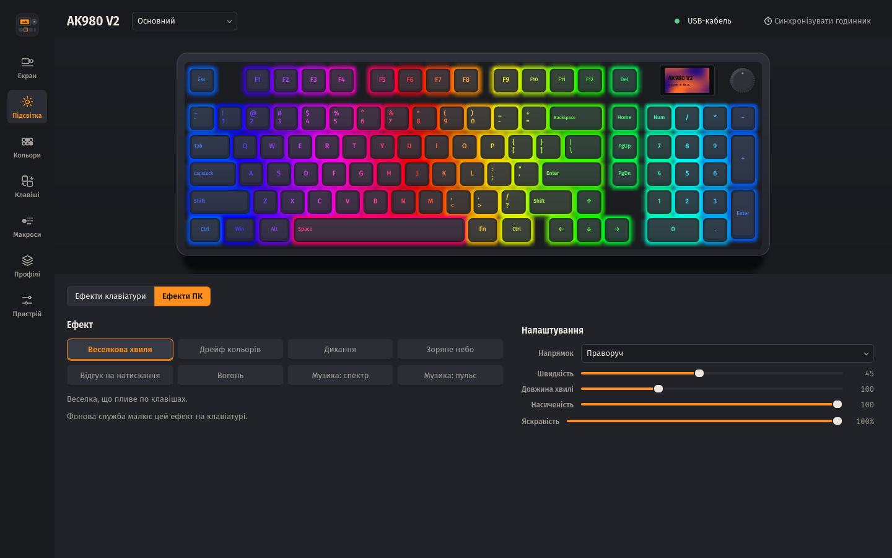
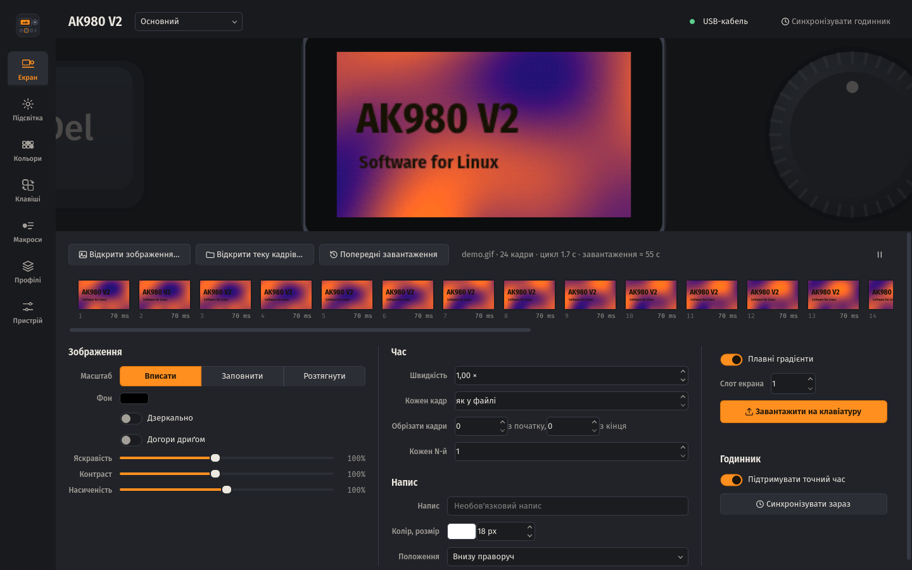
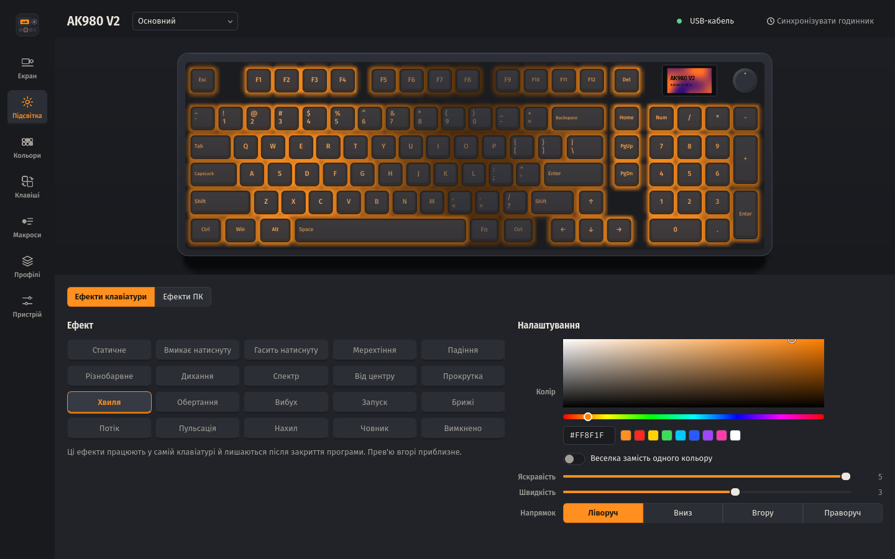
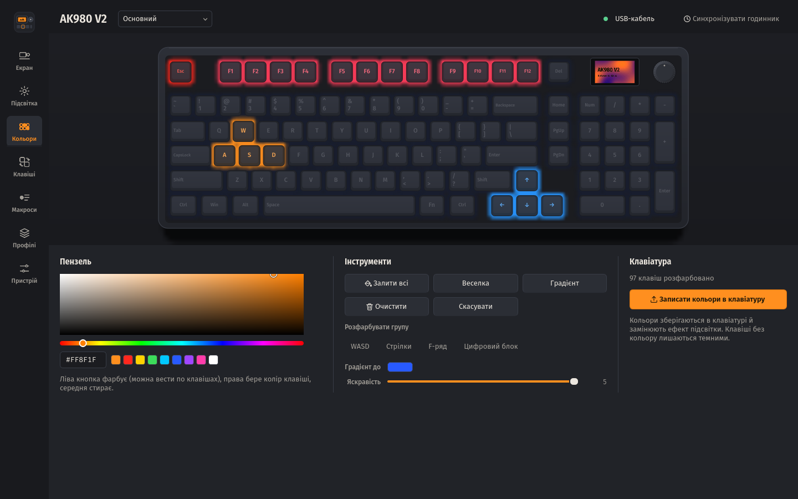
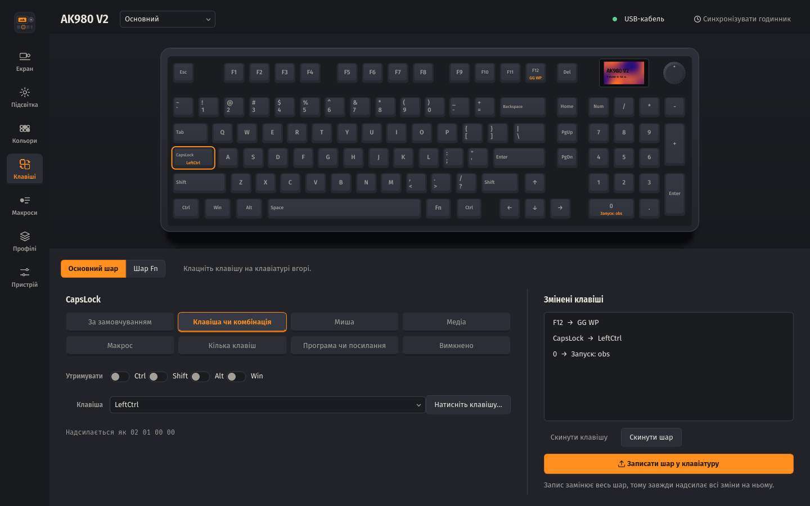
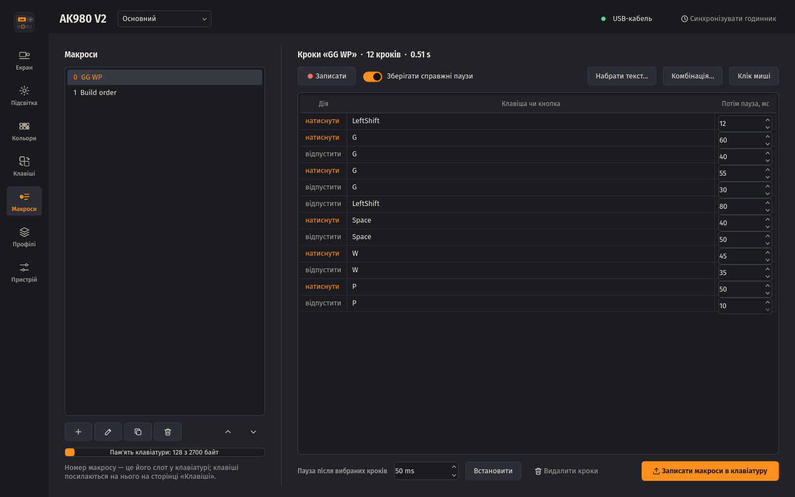
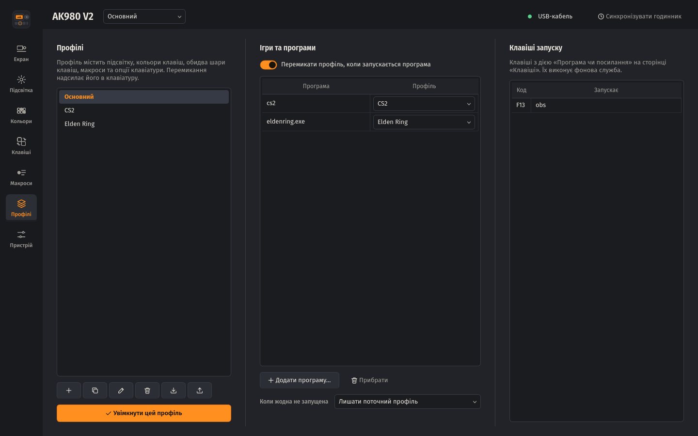
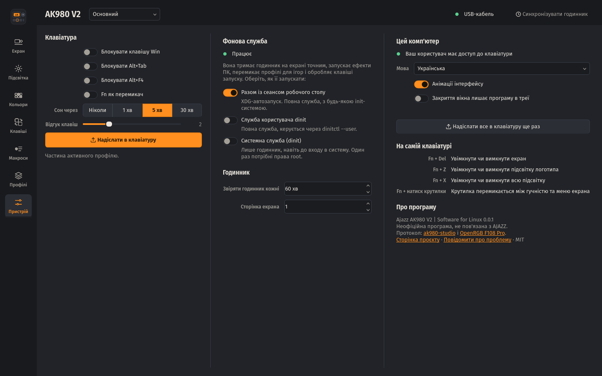

# Ajazz AK980 V2 | Software for Linux

[English](README.md) · [Протокол](docs/PROTOCOL.md) · [Дизайн](docs/DESIGN.md) · [Зміни](CHANGELOG.md)

Програма для налаштування клавіатури **AJAZZ AK980 V2** у Linux. Драйвер виробника існує лише для
Windows. Ця програма вміє все, що вміє він, і робить те, чого він не міг: годинник на екрані сам
звіряється з системою, ефекти підсвітки може рахувати комп'ютер (спектр музики, відгук на набір,
вогонь), а профілі перемикаються, коли запускається гра.



> Неофіційна програма, не пов'язана з AJAZZ. У [docs/PROTOCOL.md](docs/PROTOCOL.md#what-has-been-verified)
> перелічено, які команди і ким перевірено на справжній AK980 V2.

## Що вміє

| | USB-кабель | Донгл 2.4 ГГц |
|---|---|---|
| Тримати годинник на екрані точним (при підключенні, після сну, опівночі, щогодини) | так | так |
| GIF, зображення й теки кадрів на екрані 240×135, з редактором кадрів | так | ні (прошивка) |
| 19 ефектів підсвітки клавіатури: колір, веселка, яскравість, швидкість, напрямок | так | ні (прошивка) |
| Кольори окремих клавіш, намальовані просто на клавіатурі | так | ні (прошивка) |
| Ефекти підсвітки, які рахує комп'ютер, 30 кадрів/с | так | ні (прошивка) |
| Перепризначення клавіш на основному шарі та шарі Fn: клавіші, комбінації, миша, медіа, макроси, кілька клавіш, програми й посилання | так | ні (прошивка) |
| До 100 макросів, записаних із клавіатури або набраних | так | ні (прошивка) |
| Профілі: вручну, з трею або автоматично для гри | так | підсвітка лишається |
| Блокування Win, Alt+Tab і Alt+F4, Fn як перемикач, таймер сну, відгук клавіш | так | ні (прошивка) |
| Заряд батареї | ні (клавіатура його не повідомляє) | так |

Налаштування клавіатура приймає лише по кабелю, і драйвер виробника має те саме обмеження. Через
донгл вона приймає час і повідомляє заряд батареї.

Ефекти ПК: веселкова хвиля, дрейф кольорів, дихання, зоряне небо, відгук на натискання (клавіша,
хвиля або хрест), вогонь, спектр музики та пульс музики. Прев'ю в програмі виконує той самий код,
що й керує клавіатурою, тож бачите саме те, що світиться на клавішах.

## Встановлення

### Arch Linux, Artix і похідні

```bash
git clone https://github.com/yellowhearth1/ajazz-ak980-v2-linux
cd ajazz-ak980-v2-linux
make dist && cp dist/*.tar.gz packaging/arch/
cd packaging/arch && makepkg -si
```

`makepkg -si` збирає й встановлює `ajazz-ak980-v2-linux`. PKGBUILD зроблено як спліт-пакет у стилі
Artix: якщо потрібна системна служба, поставте поруч пакет для своєї init-системи:
`ajazz-ak980-v2-linux-dinit`, `-openrc`, `-runit` або `-s6` (юніти systemd лежать в основному пакеті).

### AppImage (будь-який дистрибутив)

Завантажте `Ajazz_AK980_V2-<версія>-x86_64.AppImage` зі сторінки
[релізів](https://github.com/yellowhearth1/ajazz-ak980-v2-linux/releases), зробіть файл виконуваним і
запустіть. При першому запуску програма один раз попросить пароль, щоб встановити правило доступу
до клавіатури. `./Ajazz_AK980_V2-*.AppImage time` та всі інші команди теж працюють.

### З вихідного коду, для свого користувача

```bash
./install.sh            # у ~/.local; sudo знадобиться лише для udev-правила
./uninstall.sh
```

Потрібні Python 3.10+, PyQt6 з QtSvg, Pillow і numpy з вашого дистрибутива.

### Інші дистрибутиви (для мейнтейнерів)

```bash
python -m build --wheel --no-isolation
python -m installer --destdir="$DESTDIR" dist/*.whl
make DESTDIR="$DESTDIR" PREFIX=/usr install-data install-systemd   # + install-openrc / -dinit / -runit / -s6
```

## Перший запуск

1. **Доступ.** Пакети встановлюють `/usr/lib/udev/rules.d/60-ajazz-ak980.rules`. Один раз
   перепідключіть клавіатуру. Без пакета програма покаже *Надати доступ* (або виконайте `ak980 setup`).
2. **Фонова служба.** Вона тримає годинник точним, запускає ефекти ПК, перемикає профілі та
   обробляє клавіші запуску. Пакети запускають її разом із сеансом робочого столу. Щоб запускати її
   як службу, оберіть варіант на сторінці *Пристрій* або:

| Init-система | Повна служба (для користувача) | Лише годинник, для всієї системи |
|---|---|---|
| будь-який робочий стіл | разом із сеансом (XDG-автозапуск) | |
| systemd | `systemctl --user enable --now ak980-agent` | `systemctl enable --now ak980d` |
| dinit | `dinitctl --user enable ak980-agent` | `dinitctl enable ak980d` |
| OpenRC | автозапуск із сеансом | `rc-update add ak980d default && rc-service ak980d start` |
| runit | автозапуск із сеансом | `ln -s /etc/runit/sv/ak980d /run/runit/service/` |
| s6 | автозапуск із сеансом | `s6-service add default ak980d-srv && s6-db-reload` |

`ak980 service list` показує, що доступно у вашій системі і що вже ввімкнено.

## Програма

Запустіть *Ajazz AK980 V2* з меню або `ak980` без аргументів. Клавіатуру намальовано за її справжньою
розкладкою, і кожна сторінка працює з нею.

| | |
|---|---|
|  | **Екран.** Відкрийте GIF, зображення або теку пронумерованих кадрів. Впишіть, заповніть чи розтягніть; підкрутіть яскравість, контраст і насиченість; змініть швидкість або дайте всім кадрам однакову затримку; обріжте кадри чи беріть кожен N-й, щоб вміститися в 140; додайте напис. Стрічка показує всі кадри з затримками: виберіть кадр, щоб змінити його затримку чи видалити. Прев'ю — це точне 16-бітне зображення, яке покаже панель. Завантаження триває близько 0,15 с на 4 КіБ. Кожне завантаження зберігається в *Попередніх завантаженнях*, бо віддати анімацію назад клавіатура не може. |
|  | **Підсвітка.** *Ефекти клавіатури* — це 19 ефектів прошивки; вони лишаються й без комп'ютера. *Ефекти ПК* рахуються тут і транслюються на клавіші, поки працює програма або фонова служба. |
|  | **Кольори.** Малюйте по клавішах: ліва кнопка фарбує (можна вести), права бере колір клавіші, середня стирає. Заливка, веселка, градієнт, WASD, стрілки, F-ряд і цифровий блок одним кліком. Кольори зберігаються в клавіатурі. |
|  | **Клавіші.** Клацніть клавішу й оберіть, що вона робить на основному шарі чи з затиснутим Fn: інша клавіша чи комбінація, кнопка або коліщатко миші, медіаклавіша, макрос (один раз, N разів, до повторного натискання, поки утримується), до трьох клавіш разом, програма чи посилання, або нічого. *Програма чи посилання* надсилає одну з вільних клавіш F13–F24, яку фонова служба перетворює на запуск програми. |
|  | **Макроси.** Записуйте з клавіатури зі справжніми паузами або без них, набирайте текст, додавайте комбінації й кліки миші, редагуйте кожну паузу. Смужка показує, скільки пам'яті макросів клавіатури зайнято. |
|  | **Профілі.** Профіль — це все, що тримає клавіатура, плюс ефект ПК. Перемикайте з шапки, трею або тут; експортуйте й імпортуйте файлами. *Ігри та програми* вмикає профіль, поки запущена програма (`cs2`, `eldenring.exe`, …). |
|  | **Пристрій.** Опції клавіатури, годинник, запуск фонової служби, доступ, мова. |

## Командний рядок

```bash
ak980 status                                 # підключення, батарея, профіль, служба
ak980 time                                   # виставити час на екрані зараз
ak980 lcd ~/Зображення/кіт.gif --fit fill    # на екран (копія в ~/.local/share/ak980/history)
ak980 lcd кіт.gif --preview out.gif          # лише подивитись, як це виглядатиме
ak980 light rotating --rainbow on            # ефект клавіатури
ak980 fx spectrum palette=fire sensitivity=70   # ефект ПК (ak980 fx --list)
ak980 custom --all 101820 --wasd ff8f1f      # кольори клавіш
ak980 remap CapsLock key:ctrl                # перепризначення; --fn для шару Fn, --dry щоб побачити байти
ak980 macro add "GG" "text:gg wp" && ak980 remap F12 macro:0
ak980 launch F13 obs && ak980 remap F1 key:F13 --fn
ak980 profile new Gaming --copy && ak980 auto add cs2 Gaming && ak980 auto on
ak980 service enable dinit-user              # як запускати фонову службу
```

Подробиці: `man ak980` і `ak980 <команда> --help`. Пакет встановлює автодоповнення для bash, zsh і fish.

## Якщо щось не так

**«Немає доступу до /dev/hidraw…»** — немає udev-правила, або клавіатуру підключили раніше, ніж
його встановили. Виконайте `ak980 setup` (або *Надати доступ*) і перепідключіть клавіатуру.

**Працює лише годинник.** Клавіатура в режимі 2.4 ГГц або Bluetooth. Підключіть кабель і перемкніть
клавіатуру в дротовий режим; драйвер виробника має те саме обмеження.

**Музичні ефекти темні.** Вони записують звук комп'ютера через `parec` (PulseAudio або PipeWire з
pipewire-pulse) чи `pw-record`. Встановіть одну з цих програм.

**Відгук на натискання не реагує.** Для читання натискань потрібна група `input`:
`sudo usermod -aG input $USER`, потім перезайдіть у систему. Клацання по клавішах у програмі працюють і так.

**Після синхронізації годинника екран перейшов на іншу сторінку.** Драйвер виробника надсилає разом
із часом номер сторінки екрана; ця програма, як і він, надсилає сторінку 1. Якщо ваш екран
використовує іншу, змініть її на сторінці *Пристрій*.

## Як це працює

Клавіатура побудована на SONiX. Налаштування йдуть 65-байтними feature-звітами на інтерфейс 3
(usage page `0xFF13`), дані екрана — output-звітами по 4 КіБ на інтерфейс 2 (`0xFF68`), а донгл
приймає 33-байтні output-звіти на своєму інтерфейсі 3 (`0xFF60`).
[docs/PROTOCOL.md](docs/PROTOCOL.md) описує кожну команду, яку використовує програма, які з них
перевірено на AK980 V2 і що досі невідомо.

Що варто знати про залізо:

* real-time потік — це `04 20` + 8 пакетів `[індекс R G B]` + `04 02`; він тягне до ~70 кадрів/с,
  але звіти, надіслані частіше ніж раз на ~1 мс, клавіатура відкидає, зупиняючи USB-канал;
* підсвіткою логотипа біля стрілок з комп'ютера керувати не можна;
* анімацію неможливо зчитати з клавіатури назад.

## Подяки

Дротовий протокол відновлено в [donglover69/ak980-studio](https://github.com/donglover69/ak980-studio)
(MIT), а real-time потік узято з
[hcode10/OpenRGB-With-AulaF108Pro-support](https://github.com/hcode10/OpenRGB-With-AulaF108Pro-support)
(AULA F108 Pro має ту саму прошивку). Цей проєкт переносить обидва на Linux, перевіряє їх на AK980 V2
і будує решту поверх. Інтерфейс використовує шрифти Fira Sans і Fira Mono (SIL OFL 1.1).

## Ліцензія

MIT, див. [LICENSE](LICENSE). Вбудовані шрифти: SIL Open Font License, див.
[ak980/data/fonts/OFL.txt](ak980/data/fonts/OFL.txt).
